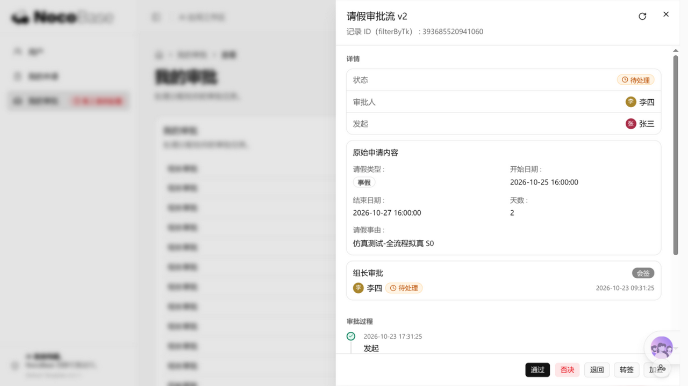
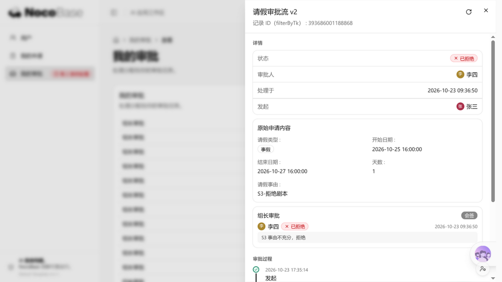
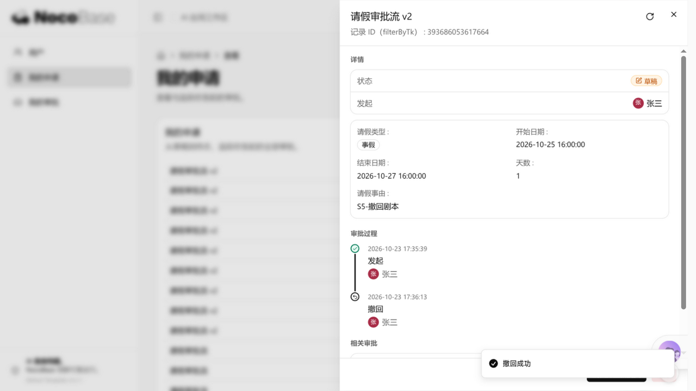

# nocobase-approval-alt

**EN** · An independently written, behaviorally compatible implementation of the NocoBase **workflow approval node** (`workflow-approval`), covering the server plugin (trigger / instruction / actions / notifications / data model) and a v3 AI-portal front-end extension. Built by black-box behavioral probing only — no official source code was accessed. For interoperability research. **Not affiliated with or endorsed by NocoBase Inc.**

> **⚠️ Disclaimer / 声明**
>
> - 本项目与 NocoBase（NocoBase Inc. / 杭州小白科技有限公司）**无任何关联、合作或背书关系**；NocoBase 及相关商标归其权利人所有。
> - 「workflow-approval」是 NocoBase 的**付费插件**。本项目是其**行为兼容的独立实现**，仅供学习、研究与互操作验证，**不得用于规避授权**；生产环境使用 NocoBase 审批能力请购买官方插件。
> - 仓库不包含任何官方产品代码、文案表或官方界面截图；实现过程中产出的官方物料仅留存于本地研究归档，不随本仓分发。
> - 代码以 AGPL-3.0 授权，**按现状提供**，不含任何担保。

## 这是什么

NocoBase 工作流引擎的「审批」节点在官方发行版中是付费插件。本项目通过**纯黑盒观测**（公开演示环境的 API 探针、行为矩阵、日志通道）还原其对外可观测行为，并给出一份**行为兼容的独立实现**：

| 组成 | 位置 | 说明 |
| --- | --- | --- |
| 服务端插件 | [`plugin-workflow-approval/`](plugin-workflow-approval/) | 触发器、审批指令、全部动作（提交/通过/否决/退回/转签/加签/撤回）、会签/或签/投票/依次协商、分支模式、通知、终态派生 |
| v3 portal 前端扩展 | [`portal/extension/`](portal/extension/) | NocoBase v3 AI portal 栈（refine + shadcn + portal-sdk）上的审批中心：我的申请/我的审批、详情抽屉、时间线、操作两级确认 |
| 验证工具链 | [`tools/`](tools/) | 一键部署验证 CI、九关冒烟、13 场景双端行为矩阵 |
| 研究文档 | [`docs/`](docs/) | 行为契约、实现记录、验证账本（15 篇） |

## 快速开始

### 前提

- 一台 **NocoBase 2.4.x** 宿主（fork 版本 2.4.0-alpha.9 上开发验证），已启用 `workflow` 引擎插件
- Node.js ≥ 20、rootless podman（CI 一键验证需要）

### 构建与安装

```bash
git clone https://github.com/<you>/nocobase-approval-alt.git
cd nocobase-approval-alt/plugin-workflow-approval
npm run build            # 产出 dist/（server + client 双 lane + externalVersion）
npm pack                 # nocobase-plugin-workflow-approval-<version>.tgz
nb plugin import ./nocobase-plugin-workflow-approval-*.tgz -e <你的环境> -y
# storage/plugins 形态下 nb plugin enable 不落库时，直接向 applicationPlugins
# INSERT (name='workflow-approval', packageName='@nocobase/plugin-workflow-approval', installed=false)，
# 应用下次启动会自装（集合同步+迁移）；并重启应用（必须真正换进程）。
```

### 一键部署验证（干净环境 CI）

```bash
tools/ci.sh                       # build → pack → 全新临时宿主 → 安装启用 → 九关冒烟 → 自动拆除
tools/ci.sh --skip-build          # 复用当前 dist
tools/ci.sh --fork <宿主源码目录>  # 指定宿主模板（默认 ~/approvals-reverse/source，可用 NOCOBASE_CI_FORK 覆盖）
```

CI 会把测试环境的插件启用面对齐你指定的主环境（`NOCOBASE_CI_MAIN_ENV`），并强制启用全部内置插件做兼容验证。报告归档 `~/approvals-ci-archive/<ts>/`（保留最近 20 轮全绿 + 全部失败轮）。

### 环境变量约定

| 变量 | 用途 |
| --- | --- |
| `NOCOBASE_ADMIN_PASSWORD` | 目标环境管理员口令（探针/冒烟脚本用，无内置默认值） |
| `NOCOBASE_USER_PASSWORD` | 测试审批人口令（fixtures 创建用） |
| `NOCOBASE_DEMO_URL` | 行为对照基准环境地址（如你自己的预发环境） |
| `NOCOBASE_CI_PASSWORD` | CI 临时环境自举口令（默认占位值） |
| `NOCOBASE_CI_FORK` / `NOCOBASE_CI_WORKSPACE` / `NOCOBASE_CI_MAIN_ENV` | CI 宿主模板 / 工作区 / 主环境名 |
| `NB_MAIN_HOME` | 本机宿主应用根目录（`dev-restart.sh` 开发循环用） |

测试账号一律**自建**（管理员 + 两名审批人即可跑通全部场景）。

### 已有宿主的开发循环

```bash
cd plugin-workflow-approval && ./dev-restart.sh   # 构建 → 同步双拷贝 → 重启（见脚本内 NB_MAIN_HOME）
```

## 界面一览（兼容实现自身截图）

| 待办详情抽屉 | 否决终态 | 撤回回草稿 |
| --- | --- | --- |
|  |  |  |

更多（发起表单、通过推进、退回重提全链）见 [`docs/screenshots/v3-portal-sim-20261023/`](docs/screenshots/v3-portal-sim-20261023/)。

## 验证方法：行为矩阵 + 中间态断言

固定剧本全绿 ≠ 行为一致。本项目用 **13 场景组合矩阵**（协商模式 × 动作 × 目标状态 × 审批人形态）对双端逐字段比对，并坚持一条铁律：

> **状态迁移链的每个中间态都要断言** —— 只比端态的断言，对「脚本会自行纠偏」的剧本天然不敏感（曾因此漏掉一个真实缺陷，后在浏览器拟真仿真中被捕获，见 docs/13 §6）。

当前判定：**12 场景 MATCH + 1 项登记偏差**（filter 编译格式审批人的解析差异，docs/13），部署验证 CI 六阶段全绿。

## 文档导览

| 篇 | 内容 |
| --- | --- |
| [01 总纲](docs/01-reverse-engineering-master-report.md) | 架构、数据模型、API 契约、状态机 |
| [02 引擎基线](docs/02-engine-baseline.md) | 开源 workflow 引擎与审批集成点 |
| [03/04 客户端分析](docs/03-client-v1-analysis.md) | 公开客户端产物的结构与行为面归纳 |
| [05 字符串面](docs/05-locale-strings.md) | i18n 键形态与插值契约（不收录原文全表） |
| [06 兼容实现记录](docs/06-implementation.md) | 包结构、部署机制、验证矩阵、已知差距 |
| [07 逐步对比](docs/07-side-by-side-comparison.md) | 同一工作流双端逐步行为对照 |
| [08 UI 复刻对照](docs/08-ui-creation-parity.md) | 建流界面与配置面板复刻 |
| [09 UI 全量审计](docs/09-ui-full-audit.md) | 页面级审计账本 |
| [10 全流程拟真测试](docs/10-full-flow-parity-test.md) | 浏览器拟真测试设计与三轮执行账本 |
| [11 部署验证 CI](docs/11-ci-cd.md) | 五阶段 CI 设计与关键机制 |
| [12 圈选注册表](docs/12-annotated-element-registry.md) | 配置抽屉元素注册表（annotation-first 方法） |
| [13 仿真矩阵](docs/13-approval-simulation-matrix.md) | 13 场景判定 + 载荷契约 + 假阳性教训 |
| [13b 前端功能点总表](docs/13-frontend-feature-inventory.md) | 317 项功能点锚点 |
| [14 v3 portal 验收](docs/14-v3-portal-parity.md) | 317 项逐项验收判定 |
| [15 请假故事 E2E](docs/15-leave-story-e2e.md) | 端到端剧本与 fixtures |

## 关键行为结论速览

- 数据模型：`approvals → rounds(approvalExecutions) → records(approvalRecords)`，records 外键回链 workflow job
- 协商模式：Or(0) / And(1) / Voting(0~1，分母=全体审批人)；顺序审批 + 加签(order ±1) + 转签(委派记录链)
- mode=0（保存前）提交建空壳记录、流程通过时才落库；mode=1（保存后）直接改现记录
- 退回两种语义：退回申请人（重新提交开新轮）vs 退回指定节点（同轮原位复用）
- 核心 job 载荷全程被重写为富形态 `{status, data, records?}`；拒绝 -5 / 退回 -6 / 撤回 -4 是引擎侧状态契约
- API 约定：`values`=POST 扁平 body、`filterByTk`=query、多数据源 `X-Data-Source` 头

## License

[AGPL-3.0](LICENSE)。本项目为独立研究实现，未使用任何官方产品代码；如需在生产环境使用 NocoBase 审批功能，请获取官方授权。
