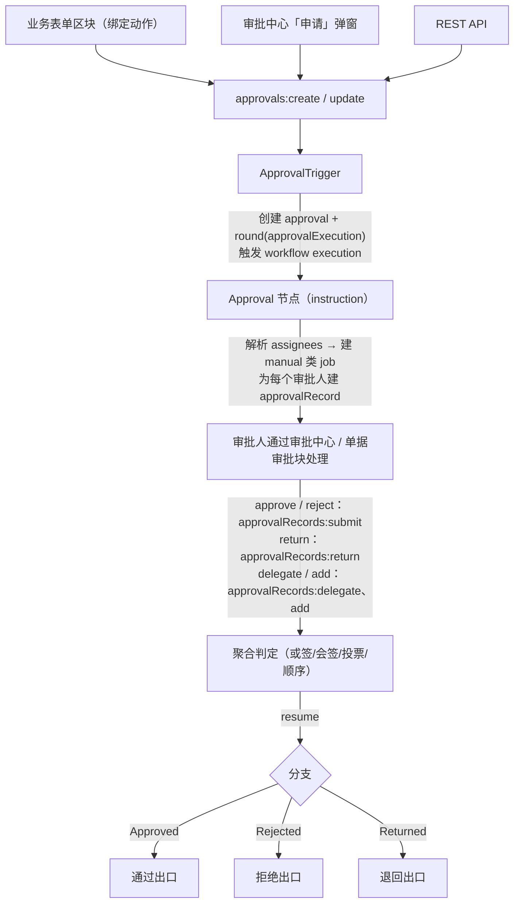
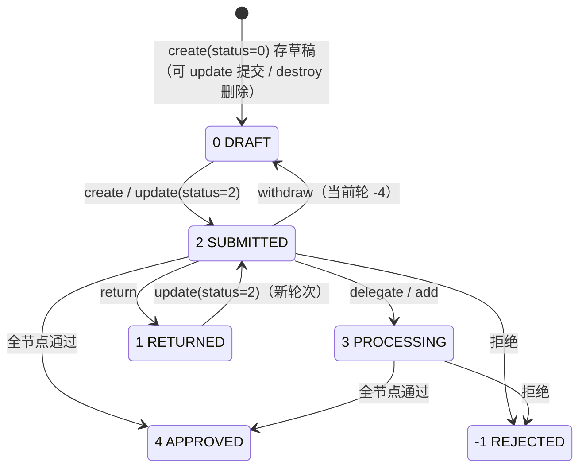

# NocoBase「审批」插件（workflow-approval）逆向工程总纲

> 目标对象：`@nocobase/plugin-workflow-approval`（NocoBase 商业插件，Professional Edition+）
> 对照版本：**2.4.0-alpha.9.20261010023252**（官方限时 demo，2026-10-10 构建）+ 本地 npm 2.4.0-alpha.9（开源部分）
> 完成日期：2026-10-13
>
> **素材来源与可信度**：
> 1. 客户端代码全量（v1 546KB + v2 302KB + 30 个异步分包，公开 CDN 分发产物）→ 前端行为全部实证
> 2. 服务端行为实测（demo root API 直调，隔离 lab 环境跑通全流程）→ API 契约与状态机实证
> 3. 开源引擎基线（@nocobase 2.4.0-alpha.9 npm 包编译产物）→ 集成点实证
> 4. 官方文档（docs.nocobase.com）→ 配置语义佐证
> 5. i18n 词条 366 条（中英双语）→ 功能清单佐证
>
> 服务端源码不可得（闭源分发、公开 npm/GitHub/官方 Docker 镜像均无），服务端结论 = 实测行为 + 客户端代码反推 + 文档，逐条标注可信度。

---

## 1. 一页总览

审批插件 = **workflow 引擎上的"审批触发器 + 审批指令（instruction）+ 人工任务分发层 + 审批中心 UI"**：

- **三张核心表**：`approvals`（审批单，含业务数据快照）→ `approvalExecutions`（轮次，对应一次 workflow execution）→ `approvalRecords`（审批人任务，绑定 workflow job）
- **双前端**：v1（uiSchemas schema UI）与 v2（flow-engine 模型 UI）并存，工作流 config 里 `approvalUid`/`taskCardUid` 指向两套之一（v2 为 flowModel uid，v1 为 uiSchema uid）；配置新版界面会强制删除旧版
- **审批中心**复用 workflow 插件的统一任务中心（`userWorkflowTasks`/`userWorkflowTaskStats`），注册 `approval-apply`（我的申请）与 `approval-todos`（我的审批）两个 taskType

---

## 2. 插件构成与依赖

| 项 | 内容 |
|---|---|
| npm 包名 | `@nocobase/plugin-workflow-approval`（商业，公共 npm 不可得） |
| 运行形态 | server 包 + client 包（`dist/client` UMD）+ client-v2 包（flow-engine UI）+ locale |
| 硬依赖 | `workflow`（引擎）、`workflow-manual`（人工节点基础，参照系）、`notification-manager`（消息模板页挂载）、`users` |
| 增强依赖 | `departments`（部门审批人/候选人选择器）、`workflow-cc`（抄送，独立插件，开源）、`multi-space` 等 |
| 分发 | registry.nocobase.com 授权下载；客户端构建产物随应用发布到 CDN `https://cdn.nocobase.com/<version>/static/plugins/@nocobase/plugin-workflow-approval/dist/{client,client-v2}/…` |

---

## 3. 数据模型

> 插件内置集合不进 `collections` 元数据表（`collections:listMeta` 不返回、无法过滤），以下字段来自 API 实测返回 + 客户端代码引用。类型标注 ⊢ 为推断。

### 3.1 approvals（审批单）

| 字段 | 类型 | 说明 |
|---|---|---|
| id | bigint |  |
| collectionName | string | 业务表名（外部数据源带 `ds:` 前缀，`parseCollectionName` 解析） |
| dataKey | string | 业务记录主键值（字符串化） |
| workflowId / workflowKey | bigint / string | 触发的工作流 |
| latestExecutionId | bigint | 最新轮次 id |
| status | int | **0 DRAFT / 1 RETURNED / 2 SUBMITTED / 3 PROCESSING / 4 APPROVED / -1 REJECTED / -2 FAILED / -3 ABORTED** |
| data | JSONB | 业务数据快照（mode=0 提交时为 `{"id":<dataKey>}` 空壳；form appends 的关联数据随 config.appends 展开） |
| action | JSONB | 提交动作摘要 `{values, actionName, resourceName}` |
| applicantRoleName | string | 申请人角色快照（测试环境值 "root"） |
| createdById | bigint | 申请人（`createdBy` 关联 users） |
| 关联 | | `rounds`→approvalExecutions（hasMany）、`records`→approvalRecords（hasMany）、`latestRound`、`workflow`、`createdBy` |

### 3.2 approvalExecutions（轮次）

| 字段 | 说明 |
|---|---|
| approvalId / executionId | 审批单 / workflow execution 双向绑定 |
| status | 进行中=None；1=完成（通过或拒绝，即 execution resolved）；**-6=退回**；-4=撤回取消（与 -5 REJECTED / -4 CANCELED 旧枚举族同源） |
| reason | 终止原因（可空） |
| snapshot | JSONB，本轮开始时的业务数据快照（实测 `{"id":1}` 级别；Snapshot 显示模式用 `snapshot ∪ dataBefore ∪ dataAfter` 还原） |

### 3.3 approvalRecords（审批任务）

| 字段 | 说明 |
|---|---|
| approvalId / approvalExecutionId | 所属审批单 / 轮次 |
| userId | 审批人 |
| jobId / executionId / nodeId / workflowId | 绑定 workflow job（注意 jobId 为**字符串**）/ execution / 节点 |
| index | 序号（顺序审批/加签排序用；加签会重排） |
| title | 任务标题（节点 title 或触发器统一标题） |
| status | **ASSIGNED=null / 0 PENDING / 1 RETURNED / 2 APPROVED / 3 UNPROCESSED / 4 PASSED / 8 DELEGATED / -1 REJECTED / -2 CANCELED / -3 WITHDRAWN / 99 ADDED** |
| comment | 评论（submit 传字符串；return 时为 commentValues 对象） |
| returnToNodeKey | 退回目标节点 key |
| type | `"Normal"` / `"Delegated"`（转签生成）/ `"Added"`（加签生成） |
| prevRecordId | Delegated/Added 记录指向原记录 |
| dataBefore / dataAfter | 处理前/后的业务数据快照（列表装饰返回） |

服务端对 `approvalRecords:get` 会装饰 `node/job/workflow/execution/user/approval/approvalExecution`，并给 record 挂 `.workflow`（demo 孤儿记录 500 报错反证）。record 旧版枚举映射（v0 迁移）：{0:PENDING, 1:APPROVED, -5:REJECTED, -6:RETURNED, -4:CANCELED}。

### 3.4 辅助集合（v2 客户端注册 8 个隐藏集合）

| 集合 | 用途 |
|---|---|
| approvalAudiences | **发起资格**（"Who could initiate"）：`{workflowId, type:"role", targetKey}`；`approvalAudiences:replace` 全量保存 |
| approvalAudienceUsers | 发起资格解析后的用户快照 `{workflowId, userId}` |
| approvalMsgTpls | 审批消息模板 `{type: todo|done, title, notificationType, template}` |
| 其余 | approvalExecutions / approvalRecords / approvals / notifications 相关（详见 04 报告 §9） |

---

## 4. 触发器（type=approval）

`workflow.config`（实测样例 + 客户端设置面板）：

| 键 | 值/语义 |
|---|---|
| `collection` | 绑定业务表（必配，"Trigger collection required"） |
| `mode` | **0=数据保存前**（通过才落库；提交即建空壳记录）/ **1=数据保存后**（先保存后审批）。通过 `approvals:create` 直接提交时两模式行为差异已实测（见 behavior-tests §1） |
| `appends` | 提交时预加载的关联字段（进 data 快照） |
| `centralized` | true=可在审批中心发起（行政类）/ false=仅数据区块动作发起（业务类）。审批中心"申请"弹窗按 `workflows:listApprovalFlows {filter:{"config":{"centralized":true}}}` 过滤 |
| `audienceType` | 1=All users / 0=Only selected users（配合 approvalAudiences） |
| `withdrawable` | 可撤回——**派生配置**：申请表单 schema 含 `WithdrawActionProvider` 区块即启用；在发起界面设计器里配置并即时 `workflows:update` |
| `recordShowMode` | 记录显示模式：false=Snapshot（进时快照+只见自己修改）/ true=Latest（始终最新）。v2 实现为 `approvalExecution.snapshot ∪ dataBefore ∪ dataAfter` vs `approvals.data` |
| `useSameTaskTitle` | true=任务标题统一用触发器标题（节点 title 失效） |
| `approvalUid` | 申请界面 uid（v2=flowModel uid；旧版为 uiSchema uid，存于 `config.applyForm`，迁移时删除） |
| `taskCardUid` | "我的申请"卡片 uid |
| `notifications` | `Array<{channel, templateType: template|custom, template}>`；todo（审批人待办通知）/ done（申请人结果通知）两类 |
| 自动通过 | 客户端证据：`Auto pass if approver is applicant`（审批人是申请人时自动通过）/ `Auto pass if approver has already approved in current round`（当前轮已通过则跳过）；节点级 `forceManualApproval` 可禁用 |
| 发起入口 | 表单区块动作绑定（同 custom-action-trigger 机制）或审批中心弹窗或 `triggerWorkflows=workflowKey` 通用 API |

**提交 API**：`POST /api/approvals:create`（body 扁平：`collectionName, data, status(0|2), workflowId`；头 `X-Data-Source`）。草稿提交用 `approvals:update`。撤回 `approvals:withdraw`，删草稿 `approvals:destroy`。

---

## 5. 审批节点（instruction type=approval）

`node.config`：

| 键 | 值/语义 |
|---|---|
| `assignees` | 审批人集合。三种配置方式：**静态用户 id 数组 / 变量**（上下文或节点结果中的用户主键/外键，数组展开合并；"从节点结果中选择审批人时仅支持用户 ID 或 ID 数组"）/ **查询条件**（用户表 filter 动态筛选）。存储形态：id 数组或 `{filter}` 对象数组 |
| `negotiation` | 协商模式：**0=Or 或签**（任一通过即通过，全拒才拒）/ **1=And 会签**（全过才过，任拒即拒）/ **0<x<1 小数=Voting 投票**（通过率 >N%，UI 输入 1-99%）。去重后仅 1 人时由其单独决定；任一人退回则节点直接退出 |
| `order` | false=并行（任意顺序）/ true=顺序（按集合次序依次处理，结果仍按协商规则）。顺序且无协商时 assignee order 必须为负（"When sequential without negotiation, order must be negative"） |
| `branchMode` | **直通模式 false**（结果只决定流程结束与否）/ **分支模式 true**（Approved/Rejected/Returned 三分支，可在分支内继续节点）。**节点创建后不可改** |
| `endOnReject` | 仅分支模式：拒绝分支末尾 ✗，分支结束后退出工作流 |
| `actions` | 启用的审批动作 = record status 枚举数组，实测 `[2,-1,1,8,99]`=通过/拒绝/退回/委派/加签 |
| `forceManualApproval` | 勾选后即使触发器开启 auto pass 也不自动通过 |
| `approvalUid` | 审批人界面（"Approver's interface"）：可放 原始提交内容 / 审批信息 / 处理表单（决定性按钮=approve/reject/return 的额外字段如评论；非决定性=delegate/add） / 自定义提示 / 我的审批卡片 |
| `taskCardUid` | "我的审批"列表卡片配置（业务字段自由选择，关系字段除外） |
| `title` | 任务标题（useSameTaskTitle 时禁用） |
| `notifications` | 同触发器结构（任务开始时通知审批人） |
| `toAddReassignees` / `toDelegateReassignees` | 加签/转签**候选人范围**（用户 id 或 `{filter}` 数组，UI "Assignees scope"；实测未配置时候选人接口返回空、委派报 `Assignee is invalid.`）；`toAddReassigneesOptions.extraFieldKey` 附加字段 |
| 退回范围 | `returnTo` 类型 ANY/COUNT/SPECIFIC/START → 任意前置审批节点 / 前置 N 个 / 指定节点 / 申请人（重走）。服务端强校验 `returnToNodeKey must be one of the configured return nodes.` |

**与引擎的集成**（基于开源基线，实证+推断混合，详见 02 报告 §8）：审批 instruction 为每个 assignee 建 manual 类 job；`Plugin.resume()` 注释点名 "sequential approval"——聚合多用户动作、仅当 job 从 PENDING 原子转终态时 resume；分支=branchIndex 子链（参照 Parallel 指令的分支聚合模式）；同节点多 job 时引擎读 MAX(id)；manual 的 submit 安全模式（job 排他锁+状态三重校验+超时 abort+事务聚合）即审批 submit 的底层。

---

## 6. API 契约（全量，实测验证）

> 调用约定（SDK 实证）：`filterByTk`/`appends`/`updateAssociationValues`/filter(JSON 串) → URL query；`values` → POST 扁平 body；多数据源走 `X-Data-Source` 头；带所属资源的动作用路径段 `/api/approvalRecords/{id}/reassignees:list`。demo 的 `__encoded__` query 为客户端批量编码（base64 JSON）。

### 读
| 端点 | 说明 |
|---|---|
| `GET approvals:get?filterByTk=&appends[]=&except[]=data` | 审批单详情 |
| `GET approvalRecords:get?filterByTk=` | 记录详情（全量装饰） |
| `POST approvals:listMine` | 我的申请（filter `{"status":[0,1,2,3]}`=进行中；completed/all 另有集合） |
| `POST approvalRecords:listMine` | 我的审批（pending filter `{"status":0,"approval":{"status":[2,3]}}`） |
| `POST workflows:listApprovalFlows` | 可发起的工作流（centralized 过滤） |
| `GET approvalRecords/{rid}/reassignees:list?type=toAdd\|toDelegate&pageSize=200&filter=` | 加签/转签候选人 |
| `POST userWorkflowTasks:listMine` / `userWorkflowTaskStats:listMine` | 统一任务箱/角标（type 含 approval-apply/approval-todos/cc/manual） |

### 写
| 端点 | body（扁平） | 效果 |
|---|---|---|
| `POST approvals:create` | `{collectionName, data, status, workflowId}` | 建审批单；status=2 触发流程；mode=0 建空壳业务记录 |
| `POST approvals:update?filterByTk=` | `{status:2, data}` | 草稿/退回后重新提交 → **新轮次** |
| `POST approvals:withdraw?filterByTk=` | `{}` 或 `{data}` | 撤回：round→-4，approval→0 DRAFT |
| `POST approvals:destroy?filterByTk=` | — | 删草稿 |
| `POST approvalRecords:submit?filterByTk=` | `{status: 2\|-1, comment, data}` | 同意/拒绝（**202**）；`values.data`=审批人提交的业务数据（mode=0 即落库数据） |
| `POST approvalRecords:return?filterByTk=` | `{status:1, comment, data, returnToNodeKey?}` | 退回（approval→1 RETURNED，round→-6） |
| `POST approvalRecords:delegate?filterByTk=` | `{assignee}` | 转签：原记录→8，新 Delegated 记录，approval→3 PROCESSING |
| `POST approvalRecords:add?filterByTk=` | `{assignee:[], order:-1\|1}` | 加签：Added 记录+index 重排（**205**） |

权限：submit 校验"当前用户是否该记录审批人"，不满足 403 `You are not assigned to this approval.`（记录不存在也返回同文案）。

---

## 7. 状态机（实测）

补充（rounds / records）：rounds: None → 1(完成) / -6(退回) / -4(撤回)；records: null→0 PENDING → 2/-1/1/8；衍生记录 type=Delegated|Added（prevRecordId 链）。

显示分组（客户端）：进行中=[0,1,2,3]，已完成=[4,-1,-2/-3 ABORTED]；待办 filter=status 0 且 approval.status∈[2,3]。

---

## 8. 前端架构

- **挂载**：不注册独立路由，以两个 taskType 挂进 workflow 统一任务中心；路由 `/admin/workflow/tasks/{approval-apply,approval-todos}/{pending|completed|all}[/{recordId}]`
- **v1**：uiSchemas（`uiSchemas:getJsonSchema/<uid>`）+ SchemaComponent 体系；处理按钮= schema 区块（x-action=状态码），按 status 动态选 submit/return
- **v2**：flow-engine（`flowModels:findOne?uid=`）45 个懒加载 FlowModel（ApprovalTaskCardDetailsModel / ApplyTaskCardDetailsModel / ApprovalDetailsModel / ProcessFormModel 等）；Snapshot/Latest 在 ProcessFormModel.getFormRecordStrategy 实现；v1→v2 迁移器内建
- **通知模板页**：挂 notification-manager 设置页新增 "Approval message templates" 页签（approvalMsgTpls CRUD）
- 完整细节：`03-client-v1-analysis.md`、`04-client-v2-analysis.md`

## 9. 复刻要点清单（给自研实现）

1. 三表模型 + 轮次（approvalExecutions）设计是退回/重提/撤回的骨架；records 必须外键回链 job
2. submit 幂等与并发：参照 manual 的 job 锁 + 三重状态校验 + 事务内聚合 + resume（引擎注释点名的 sequential approval 契约）
3. 协商判定：单审人直判；Or=任一终态；And=全过/任拒；Voting=通过率阈值；任一退回即节点退出
4. mode=0 的两阶段数据：提交建壳 → 通过时以审批人 data 落库；mode=1 直接改现记录
5. 加签/转签是"记录衍生"而非修改：Delegated/Added 记录 + prevRecordId + index 重排，候选人范围服务端强校验
6. 审批中心走 workflow 任务中心注册表（taskType + taskStats provider），不要另起炉灶
7. ACL：approvals/approvalRecords 全部走专用 action（非通用 CRUD），按"申请人/审批人/管理员"三类角色裁剪

## 10. 证据索引

| 文件 | 内容 |
|---|---|
| `api-captures/behavior-tests.md` | 服务端行为实测全记录（含全部请求/响应样例） |
| `docs/02-engine-baseline.md` | 开源 workflow 引擎基线与 12 项集成点 |
| `docs/03-client-v1-analysis.md` | v1 客户端逐行分析（12 章） |
| `docs/04-client-v2-analysis.md` | v2 客户端逐行分析（11 章，45 模型清单） |
| `docs/05-locale-strings.md` | 中英双语 366 词条 |
| `api-captures/*.json` | flowModel 样例、双语 locale 全量 |
| `bundles/` + `analysis/` | 全部客户端产物与美化副本 |

**主要未决项**：投票模式服务端判定细节（客户端证据充分）；PROCESSING(3) 的完整触发条件集合；mode=0 最终落库的确切时机；server 端 assignees 变量/查询条件解析的完整实现（客户端只见配置面）。
