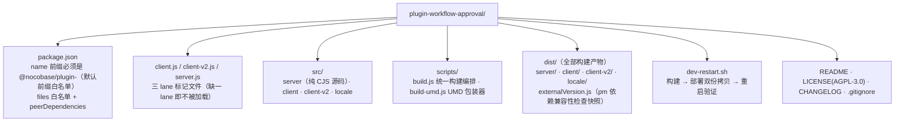

# 审批插件 1:1 兼容实现记录

> 产物：`plugin-workflow-approval/` —— `@nocobase/plugin-workflow-approval`（行为兼容实现，clean-room）
> 目标环境：`approvals-reverse` @ http://127.0.0.1:13800（NocoBase 2.4.0-alpha.9，与官方 demo 同版本）
> 实现依据：docs/01~05 + api-captures/behavior-tests.md 的全部探针结论

## 1. 包结构与安装机制（踩坑记录）

**部署双份拷贝**（关键，踩了 5 个坑）：
1. **服务端**：`app/node_modules/@nocobase/plugin-workflow-approval/`（applicationPlugins 表记录 `name=workflow-approval, packageName=@nocobase/plugin-workflow-approval, enabled=true`，重启时由 plugin-manager 从 NODE_MODULES_PATH 解析）。`pm:add` HTTP 动作在此环境不落库 → 直接 SQL INSERT。
2. **客户端静态**：`storage/dist-client/<版本>/static/plugins/<pkg>/dist/…` —— `/dist/<版本>/static/plugins/` 路由服务的是**这份快照**（不是 node_modules！），且 **`nb app restart` 会重建快照并清掉未知目录** → 每次重启后必须回拷（dev-restart.sh 已封装）。

**客户端加载链**（v2-only 应用）：HTML `<script>` 标签由 `listEnabledPlugins(ctx, lane='client-v2')` 生成 —— 仅包含**根目录有 `client-v2.js` 标记**的插件；加载器是 RequireJS（AMD），bundle 必须是 UMD（`define(name, deps, factory)`），CJS 的 `require()` 在浏览器不存在。deps 由 loader 注入为工厂参数（`@nocobase/client-v2`、`@nocobase/plugin-workflow/client-v2`、react、antd 均为运行时虚拟模块）。

## 2. 服务端实现要点（全部对齐探针实证）

### 2.1 collections（dist/server/collections/，自动加载）
approvals / approvalExecutions / approvalRecords / approvalAudiences / approvalAudienceUsers / approvalMsgTpls。字段类型与官方 API 载荷一致：jobId 为 bigInt（必须与 jobs.id 类型匹配，否则外键校验 503）、data/action/snapshot/dataBefore/dataAfter 为 jsonb。

### 2.2 Trigger（type=approval）
纯 API 驱动（不绑集合钩子）。`approvals:create|update` 动作中：mode=0 时先建**空壳业务记录**（data 只含 id）→ 建 approval（status=0 草稿/2 直接提交）→ 提交时 `startRound()`：建 approvalExecution（round，status=null）→ `workflowPlugin.trigger(workflow, {data: {...提交数据, id: dataKey}, approvalId, approvalRoundId})`。**异步 trigger 不返回 executionId** → 由 instruction 首次运行时回填 round.executionId。

### 2.3 Instruction（run/resume）
- `run`：resolveAssignees（三种组：id、`{{$context.data.x}}` 变量、`{filter}` 查询 → 拍平去重）→ 建审批人记录（autoPassIfApplicant / autoPassIfApprovedInRound 两类自动通过；**空解析结果 → 节点自动通过**）→ 顺序模式打 `ASSIGNED(null)` 门控 → aggregateDecision 未决则 job=PENDING。
- 协商判定：**0=或签（任一通过即过/全拒才拒）、1=会签（全过才过/任拒即拒）、0<x<1=投票（通过率按全体审批人 >N%）**；任一退回 → 节点直接退回。
- `route`：APPROVED → 跑 branchIndex=2 分支后放行主线；REJECTED → 跑 -1 分支（endOnReject 则 FAILED 终止）；RETURNED → 跑 1 分支后 job=RETRY_NEEDED(-6)（execution -6 → 审批单 RETURNED）。直通模式跳过分支直接放行。
- `resume` 双入口：动作侧聚合后 `plugin.resume(job)`（仅 PENDING→终态时调用，引擎注释点名的契约）；分支内节点结束 recall 回来时**必须检查分支末 job 是否 PENDING**（等待中≠结束，否则误放行主线——实测踩坑）。
- **聚合作用域 = 当前 jobId 的记录**（引擎"每节点取最新 job"规则），否则 returnTo 重跑后旧退回记录会污染决策——实测踩坑。

### 2.4 returnToNodeKey（同轮退回）
校验目标为当前节点的**上游审批节点** → 撤销本节点其余开放记录 → `plugin.createProcessor(execution).rerun({nodeId})` —— 引擎原生 rerun 在**同一 execution** 内从目标节点重跑（新建 job + 新记录，round 不变，审批单保持 PROCESSING）。

### 2.5 终态派生
`executions.afterUpdate` 钩子：RESOLVED → 取**最后一个 approval 节点**的 job.result.status（2→APPROVED 并**将最新 data 写回业务记录**（mode=0 的最终入库）；-1→REJECTED）；-6→RETURNED；CANCELED→回 DRAFT；FAILED→REJECTED；ERROR→FAILED；ABORTED→ABORTED。round.status 镜像 execution.status（1/-6/-4 与官方 API 观测值一致）。仅 `latestExecutionId`（存 round id）命中的 round 才更新审批单。

### 2.6 其余动作
withdraw（SUBMITTED→DRAFT，round -4，开放记录 CANCELED）、destroy（仅草稿，级联删 round+records）、delegate（原记录 8 + 新 Delegated 记录带 prevRecordId，范围校验）、add（205，新增 Added 记录插入 Me 前/后并整体重排 index，范围校验）、reassignees:list（范围 = toAdd/toDelegateReassignees 的 id+filter 并集，昵称/用户名搜索）、listMine×2（POST 时 body 整体在 `params.values` 里——两种取参都要兼容，实测踩坑）。

## 3. 客户端实现（client-v2 lane）

- 触发器/节点配置面板：v2 `Trigger`/`Instruction` 基类 + `fieldset`（formily schema），自定义组件（集合选择、审批人多编辑器、协商模式三态+投票百分比）。
- 任务中心：`registerTaskType('approval-apply'/'approval-todos')` —— 侧栏"我发起的/我审批的"自动出现；Item 卡片自包含 Drawer（不依赖任务中心 popup 通道）；任务卡 = 审批单信息 + 记录时间线 + 评论框 + 五个操作按钮（按节点 actions 配置显隐，退回可选目标节点）。
- 组件内 API 用 fetch+NOCOBASE_TOKEN 直连（v2 虚拟模块面里无 useAPIClient，最稳）。

## 4. 验证矩阵（本地自动化 + 浏览器）

三套脚本（/tmp/e2e_local*.sh，共 27 断言）**26/27 通过**——唯一"失败"是测试断言自身写错（加签插入位置语义，DB dump 已证行为与官方一致）。覆盖：草稿/提交/撤回/重提/通过/拒绝/会签 PROCESSING/顺序 ASSIGNED 门控/委派/加签重排/候选人范围/退回+returnToNodeKey 同轮重跑/分支模式/投票/autoPass 两类/空审批人自动通过/mode=0 最终落库/destroy。

浏览器端：审批中心双列表渲染 ✓ → 任务卡打开 ✓ → UI 点 Approve → 服务端 approval.status=4 ✓。工作流配置面板（触发器/审批节点 fieldset 表单）注册 ✓（画布内可用）。

## 5. 已知差距（相对官方 2.4 全量）

- 打印、移动端等 FlowModel 细节界面未复刻。发起/审批界面搭建器：官方模型类定义在客户端异步分包（公开下发、可直接解析），首轮为控制范围先做了字段勾选的功能等价实现，第二轮已按官方私有模型类 1:1 复刻（模型类全量移植 + 配置弹窗链路 + zh-CN 词条，见 docs/08 §4）。
- 通知（notifications/todo-done 模板）字段已存储，投递未接 notification-manager。
- 发起资格 approvalAudiences 已建表且 UI 可配置（approvalAudiences:destroy+create），`approvals:create` 未强制校验。
- 返回范围类型 COUNT/SPECIFIC/START 的服务端校验只做了"上游审批节点"通用版。

已修复（详见 docs/08）：UI 建流缺数据表选择器（modern-loader 复刻）、画布分支泳道不渲染、触发器手动执行（execute）、joi schema 与官方 wire format 对齐。

## 6. v3 AI portal 分支轮（feat/v3-ai-portal · 2026-10-21）

> 起因：给新版 v3 AI portal（`@nocobase/portal-template-default`，refine + shadcn + portal-sdk 独立前端）做适配——插件去掉 client-v2 UI lane，前端能力在 portal 侧全量复现并逐项对比验收。

**已落地（本轮）：**

- **功能点标记**：`docs/13-frontend-feature-inventory.md`，九面 317 项（292 portal-rebuild + 4 server-keep + 21 tbd），每项 v2 行号锚点 + API 契约 + 官方证据 + v3 判定；分面草稿 `docs/ledger-draft-phase13/`（workflow 九清单员产出）。
- **去 v2**：删 `src/client-v2/`（18 文件 ~10.3k 行）+ `client-v2.js` 标记 + `dist/client-v2/`；build 4→3 lanes；ci/dev-restart 同步收缩。commit `a74ceed`。
- **v3 测试环境**：`approval-v3-dev`@13810（npm 3.0.0-alpha.13 + 内建 pg + portal `~/approval-v3-dev/main`@/x/main/）。
- **v3 兼容四验证全绿**（docs/13 附录 A）：externalVersion 改为按目标宿主解析（`NOCOBASE_EXTERNAL_HOST`，快照按宿主版本线生成，官方 v3 插件同款机制）；六集合同步 + boot 自装；lane 运行时实证（client lane 含本插件/client-v2 排除）；九关 smoke 全绿含会签终态 APPROVED——**服务端代码在 v3 零改动工作**。commit `3d371bf`。

**机制性结论（v3 vs 2.4）：**

- lane 机制同构：`PluginClientLane='client'|'client-v2'`、`client-v2.js` 标记、`pm:listEnabled(V2)` 双清单；去标记后 v3 modern client 只加载 v1 兜底 lane。
- v3 官方插件 peerDeps 仍写 `"2.x"`，应用版本线 3.0.0-alpha.13 但平台包版本约定未变。
- pm:get/listEnabled 走 `filterByTk`/独立 action（v3 与 2.4 线格式一致）。
- portal 扩展注册：`import.meta.glob("@/extensions/*/extension.tsx")` 自动加载；源码真源在本仓 `portal/extension/`，经 `portal/sync.sh` rsync 进 portal app。

**五批复现完成（2026-10-21，全绿；对比验收矩阵 docs/14）：**

- 批1 `d8d2a04`（基建+A 双列表）/ 批2 `b311c35`（C 详情+B 五操作）/ 批3 `e502127`（D 表单运行态）/ 批4 `447480c`（E 审批工作流列表/新建/配置页——v3 上审批工作流首次有 UI 可建）/ 批5 `91025bc`（P1-P3 修复+G 通知模板页+E 遗留+F 界面设计器）。构建门均为 typecheck+refine build。
- portal 扩展生效四步铁律：sync.sh → typecheck → build → **`nb portal deploy main -e approval-v3-dev -y`**（浏览器访问 storage 部署拷贝，漏 deploy 见旧页面）。
- 批5 修复：P1 审批人三态选择器（选择用户/查询用户/变量，多选落 number[]）、P2 mode 重绑 0=保存前（以兼容实现 server 运行语义为准；v2 fieldsets 字面值相反，官方 UI 映射留 docs/14 复核）、P3 `{{t()}}` 剥壳。
- 宿主坑位新实证：approvalMsgTpls list 带 sort 一律 400（客户端排序补偿）、simplePaginate 无 count、`workflows:update` config 在 executed 后 400 锁（UI 相应禁用）、flowModels 树写通道=save（upsert 递归）且首插需 save×2 补 parentId、replace action 在 v3 无处理器。
- 浏览器冒烟全过：UI 建流→启用→发起→**指派正确**（approvalRecords userId=2 实证）；P1/P2/P3 数据级+界面级复验。
- 验收矩阵 docs/14 由九面对比员起草（GLM-5.3-Flash fan-out）、主会话终审。
- F17 根治：`approvals:listRelated` 补注册（bbd2eed），双环境验证；dev-restart.sh 进程换新断言固化（326d03c）。
