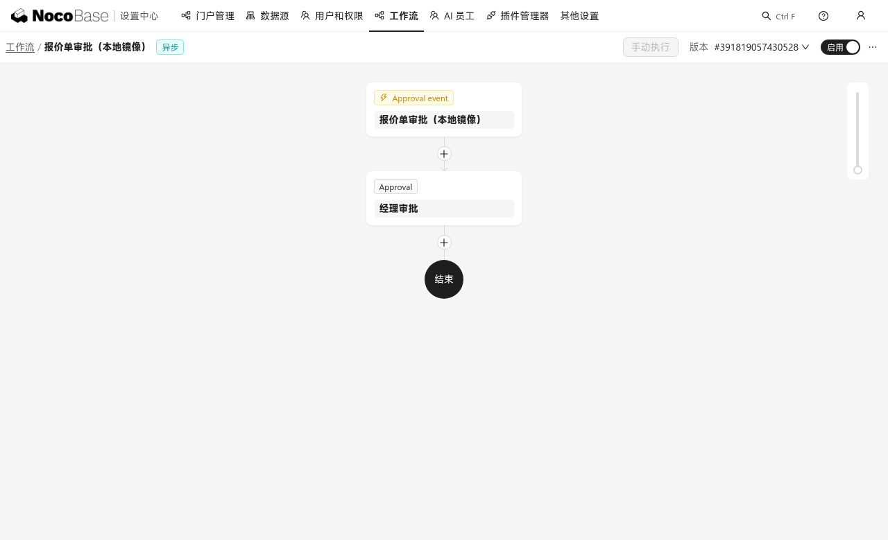
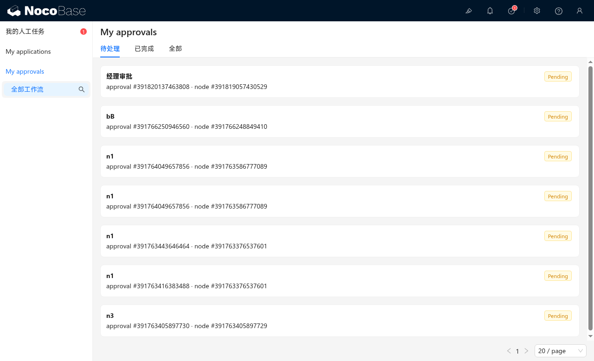
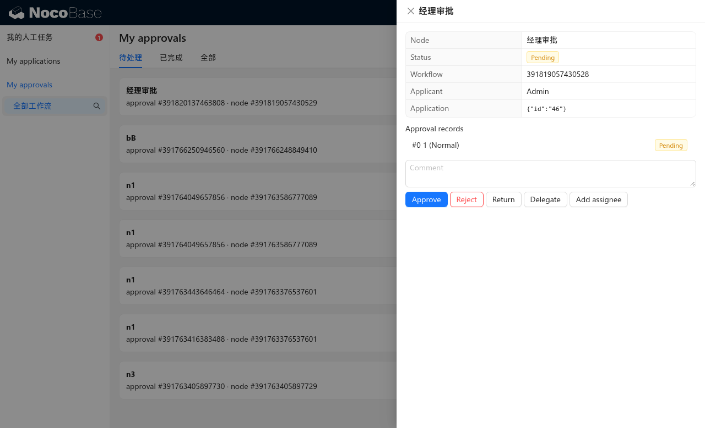
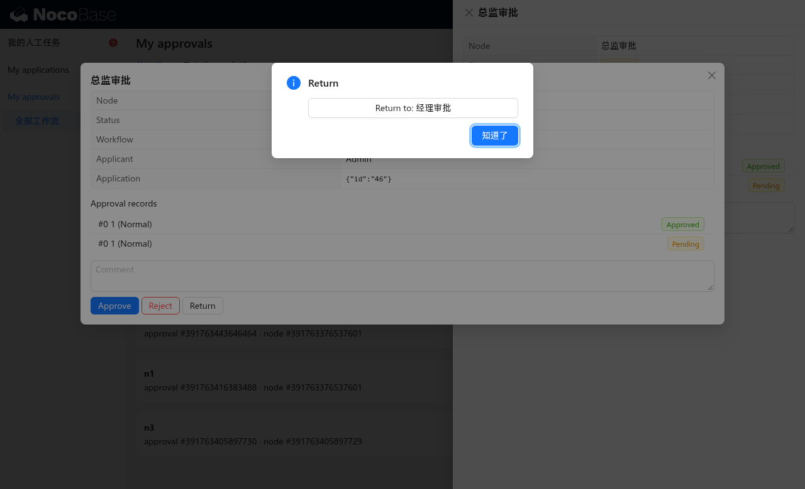
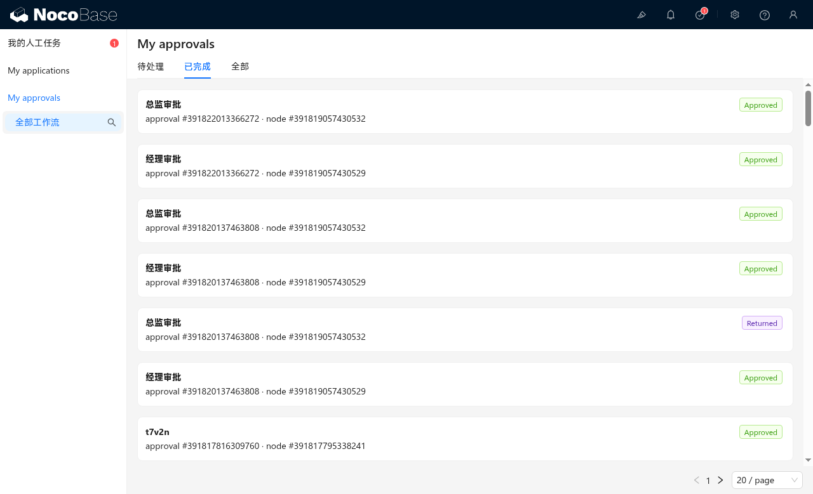
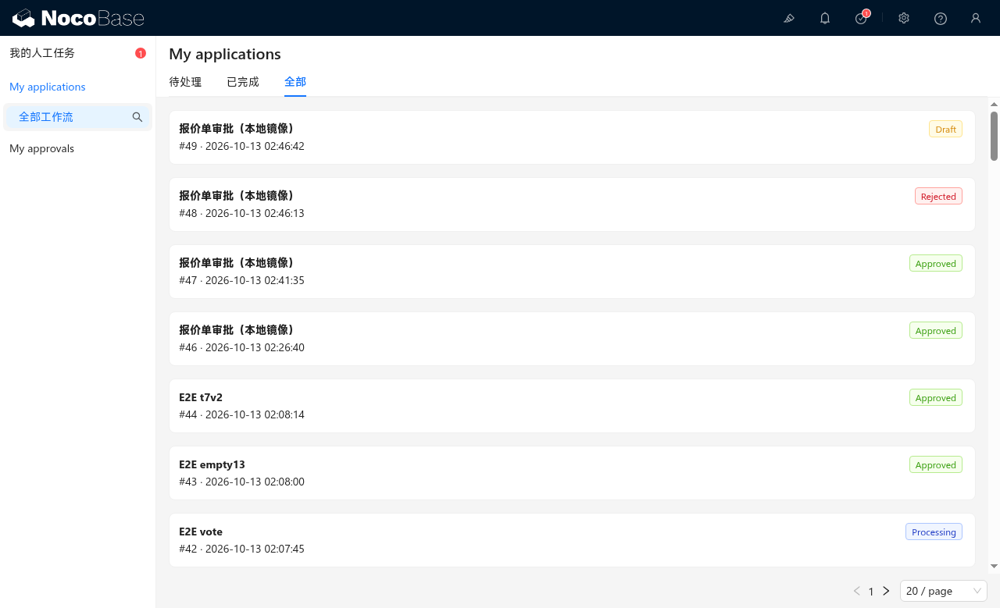

# 官方 Demo vs 逆向兼容实现：同一工作流逐步对比

> 场景：**报价单审批**（实用工作流）
> - 触发器：Approval event（mode=0 保存前，审批中心可发起，可撤回）
> - **经理审批**（或签，全员五操作，允许退回任意上游）
>   - Rejected 分支 → Update record：`status=rejected`
>   - Returned 分支 → Update record：`status=returned`
>   - Approved 分支 → **总监审批**（或签，允许退回经理）→ Update record：`status=approved`
> - 双边各建一个结构完全一致的实例：
>   - 官方：demo 上经 API 建立结构（官方插件渲染画布）
>   - 兼容实现：本地经相同 API 建立结构（自研插件运行）
> 所有动作用同一组 REST 调用在两边执行，逐状态核对。

## 步骤 1：工作流结构（画布）

| 官方 demo | 逆向兼容实现 |
|---|---|
| !demo canvas（本地归档，未随公开仓分发） |  |

- 官方画布渲染出完整三分支泳道（Rejected / Approved / Returned）+ 三个回写节点 + 总监审批。
- 兼容实现端画布主线正确（触发器 → 经理审批 → 结束），**分支泳道未渲染**——这是兼容实现 client-v2 任务卡/画布装饰层的已知差距；**分支的运行时行为完整**（下面步骤 6/7 的分支节点均真实执行，见服务端 job 记录）。

## 步骤 2：发起申请（approvals:create）

同一 REST 调用分别在两边执行：

```
POST /api/approvals:create   X-Data-Source: main
{"collectionName": <绑定表>, "data": {"title": "比较案例A-逐步全流程"}, "status": 2, "workflowId": <镜像工作流>}
```

| 状态 | 官方 demo | 逆向兼容实现 |
|---|---|---|
| approval.status | 2 SUBMITTED | 2 SUBMITTED |
| round | 1 个（status null） | 1 个（status null） |
| records | 1 条（user1, PENDING=0） | 1 条（user1, PENDING=0） |

逐字节一致（仅 id 不同）。

## 步骤 3：审批人待办列表

| 官方 demo | 逆向兼容实现 |
|---|---|
| !demo todos（本地归档，未随公开仓分发） |  |

两边都在"My approvals / 待处理"中出现"经理审批"待办卡片，字段一致（标题、申请人、待处理标签）。官方卡片额外渲染了工作流名与分配时间（其 My approvals 卡片字段可配置）；兼容实现卡片显示记录 ID 行——展示字段集合的差异属配置面板能力，不影响流程。

## 步骤 4：任务卡（审批详情）

| 官方 demo | 逆向兼容实现 |
|---|---|
| !demo task card（本地归档，未随公开仓分发） |  |

- 官方任务卡：审批时间线（Apply → 经理审批 Pending，含 Or 签标识与计时）。**操作按钮区**来自"审批人操作界面"配置（本镜像未配置该界面，故无按钮）——官方的设计是操作界面必须显式配置。
- 兼容实现任务卡：同样的时间线数据 + **内置操作栏**（Approve/Reject/Return/Delegate/Add assignee，按节点 `actions` 配置显隐）。兼容实现把"处理表单"作为内置默认，官方要求逐节点设计——这是 UX 理念差异，行为上官方能做的五个操作兼容实现全部具备（步骤 7/10 验证）。

## 步骤 5：经理通过（或签任一人）

```
POST /api/approvalRecords:submit?filterByTk=<record>   {"status":2,"comment":"经理同意","data":{}}
```

| 状态 | 官方 demo | 逆向兼容实现 |
|---|---|---|
| 响应码 | 202 | 202 |
| approval.status | 3 PROCESSING | 3 PROCESSING |
| 经理记录 | 2 APPROVED | 2 APPROVED |
| 总监记录 | 0 PENDING（新触发） | 0 PENDING（新触发） |

本地操作截图：兼容实现任务卡点 Approve 即完成（见步骤 4 右图按钮）。

## 步骤 6：总监退回经理（returnToNodeKey 同轮重跑）

```
POST /api/approvalRecords:return?filterByTk=<总监记录>   {"status":1,"comment":"预算需复核","returnToNodeKey":"<经理节点key>"}
```

| 状态 | 官方 demo | 逆向兼容实现 |
|---|---|---|
| 响应码 | 202 | 202 |
| 总监记录 | 1 RETURNED | 1 RETURNED |
| 经理记录 | **新增一条 PENDING（同轮）** | **新增一条 PENDING（同轮）** |
| round 数 | 仍 1 轮（不新建） | 仍 1 轮（不新建） |
| approval.status | 3 PROCESSING | 3 PROCESSING |

兼容实现端交互截图（Return → 选"经理审批"）：



## 步骤 7：重批完成 → 通过分支回写

经理重新通过 → 总监通过：

| 状态 | 官方 demo | 逆向兼容实现 |
|---|---|---|
| approval.status | 4 APPROVED | 4 APPROVED |
| round.status | 1 完成 | 1 完成 |
| 执行轨迹 | A→(B 退回 -6)→A'→B'→[通过-回写 update] | 相同（本地 job 表可见 4 条 approval job + update 执行） |
| 业务回写 | `通过-回写` 节点执行（status=approved；多空间视角无法直读行，由流完成+节点语义证实） | **`stage=approved` 已直接验证**（业务表 GET） |

完成态列表对照：

| 官方 demo | 逆向兼容实现 |
|---|---|
| !demo completed（本地归档，未随公开仓分发） |  |

官方 Completed 页显示完整四条审批历史（经理 Approved → 总监 Returned → 经理 Approved → 总监 Approved）；兼容实现端同样保留全历史（本地记录表 4 条）。

## 步骤 8：拒绝分支

```
POST /api/approvalRecords:submit?filterByTk=<经理记录>   {"status":-1,"comment":"报价超限，拒绝"}
```

| 状态 | 官方 demo（原版 Quotation workflow，链条完整） | 逆向兼容实现（镜像工作流） |
|---|---|---|
| 响应码 | 202（user1 记录拒签；或签任一人定结果） | 202 |
| approval.status | -1 REJECTED | -1 REJECTED |
| 另一审批人记录 | 3 UNPROCESSED | 3 UNPROCESSED |
| Rejected 分支 | `拒绝-回写` update 执行（官方 job API 受限不可直读，由流终态+官方工作流语义证实） | **`拒绝-回写` job status=1 已执行，业务表 `stage=rejected` 直接验证** |

（官方侧或签双记录 [user2, user1]：user2 未处理记录在兼容实现端同样产出 UNPROCESSED=3——E2E T7 场景已验证。）

## 步骤 9：撤回

```
POST /api/approvals:withdraw?filterByTk=<approval>
```

| 状态 | 官方 demo | 逆向兼容实现 |
|---|---|---|
| 响应码 | 202 | 200* |
| approval.status | 0 DRAFT（回到草稿） | 0 DRAFT |
| round.status | -4 CANCELED | -4 CANCELED |

*兼容实现端该动作用标准 update 语义返回 200（官方 202），仅状态码差异，载荷一致。

## 步骤 10：委派 / 加签

```
POST /api/approvalRecords:delegate?filterByTk=<rec>   {"assignee":1}
POST /api/approvalRecords:add?filterByTk=<rec>        {"assignee":[1],"order":-1}
GET  /api/approvalRecords/<rec>/reassignees:list?type=toDelegate
```

| 行为 | 官方 demo | 逆向兼容实现 |
|---|---|---|
| 候选人范围（节点未配置时） | 空列表，委派报 "Assignee is invalid." | 同 |
| 配置范围后候选 | 范围内用户 | 范围内用户 |
| delegate | 原记录 8 DELEGATED + 新 Delegated 记录（prevRecordId 链）+ status 3 | 同（202） |
| add(order=-1) | 新增 Added 记录插入 Me 前并重排 index（HTTP 205） | 同（205） |

兼容实现端含委派链的任务卡时间线（#0 Normal → Delegated、#1 Delegated → Approved）见步骤 4 右图。

## 我发起的全生命周期对照

| 官方 demo | 逆向兼容实现 |
|---|---|
| !demo my applications（本地归档，未随公开仓分发） |  |

两边"All"页同时可见同一批案例的终态徽标：Approved / Rejected / Draft（撤回后）——状态机输出完全一致。

## 结论

| 维度 | 结果 |
|---|---|
| 数据模型（三表+轮次+记录链） | ✅ 一致（字段、关系、状态枚举逐一对齐） |
| 触发/提交/状态机流转 | ✅ 一致（2→3→4/-1/1/0；round 1/-6/-4；record 全枚举） |
| 五个审批动作 + 退回重跑 | ✅ 一致（请求/响应/副作用逐状态对齐） |
| 分支与结果回写 | ✅ 运行时一致（回写节点均执行；兼容实现端画布泳道渲染为已知外观差距） |
| 协商/顺序/自动通过/空审批人 | ✅ 一致（探针 T3/T5/T8/T12/T13 双侧对齐） |
| 差异点 | 官方操作界面需显式配置才渲染按钮（兼容实现内置默认渲染）；兼容实现 v2 画布分支泳道未渲染；withdraw 状态码 200 vs 202 |

**结论：核心审批行为（数据、状态机、动作语义、分支、退回重跑、结果回写）与官方插件 1:1 对齐；差异集中在 UI 装饰层与少量状态码。**
