# 08 · UI 建流复刻对照（官方 demo vs 兼容实现逐步走查）

> 背景：此前兼容实现的 UI 建流缺少触发器的数据表选择器（`config.collection` 为空导致运行失败），
> 且审批节点/触发器的配置面板与官方不同。本次按官方 demo 的操作逻辑逐步走查，
> 从官方客户端懒加载 chunk 中提取真实 fieldset 结构，在兼容实现客户端 1:1 复刻，
> 并在本地用同样步骤复现验证。本篇记录每一步的双边对照。

## 1. 官方实现来源（客户端 chunk 提取）

官方 `plugin-workflow-approval` 的 client-v2 是懒加载分 chunk 的，配置表单不在主 bundle：

| Chunk | 模块 | 内容 |
| --- | --- | --- |
| `483` | 1182 | `ApprovalTriggerFieldset`（触发器配置面板全表单）、`ApprovalPresetFieldset`（建流时的数据表选择器）、「谁可以发起」audiences 组件 |
| `617` | 9264 | `ApprovalFieldset`（审批节点配置面板）、`ApprovalPresetFieldset`（加节点时的模式单选）、`ApprovalCanvasComponent`（节点卡片 + 三分支泳道渲染）、审批人拖拽列表、或签/会签/投票 |
| `863` | 674 | 触发器节点「测试运行」表单（触发数据 / 申请人 / 申请人角色） |

注册机制（本地 2.4.0-alpha.9 workflow client-v2 同构验证）：触发器/指令类暴露
`PresetFieldsetLoader` / `FieldsetLoader` / `ComponentLoader` / `TriggerFieldsetLoader`
（返回 `Promise<{default: Component}>`）时进入 **modern-loader** 模式；
否则回退 legacy `fieldset` JSON schema（兼容实现旧实现走的是这条路，且组件名未注册 → 表单空白 → 正是缺数据表选择器的根因）。

关键行为（从 chunk 反编译确认）：
- 触发器 `validate(config) = !!config.collection`；`createDefaultConfig = { mode: 0, centralized: false, audienceType: 1, recordShowMode: false, useSameTaskTitle: false }`
- 建流表单在切换触发器类型时把 `config` 重置为 `{}`，提交只存 `{collection}`（官方 demo 存储：`{"collection":"tickets"}`，**不含 mode**）
- 加节点弹窗提交 `{key,type,upstreamId,branchIndex,title,config:{...instruction.createDefaultConfig(),...表单值}}`；审批节点 `createDefaultConfig = { approvalUid: randomId('approval_') }`，`branching(branchMode)` 返回 通过(2)/拒绝(-1)/退回(1)
- 画布分支渲染需自定义 `ComponentLoader`：`NodeDefaultView` 包裹三个 `Branch`（REJECTED=-1 / APPROVED=2 / RETURNED=1），`end = RETURNED || (REJECTED && endOnReject)`

## 2. 逐步对照

### 步骤 1 · 新建工作流抽屉

| 官方 demo | 兼容实现本地 |
| --- | --- |
| !demo（本地归档，未随公开仓分发） | 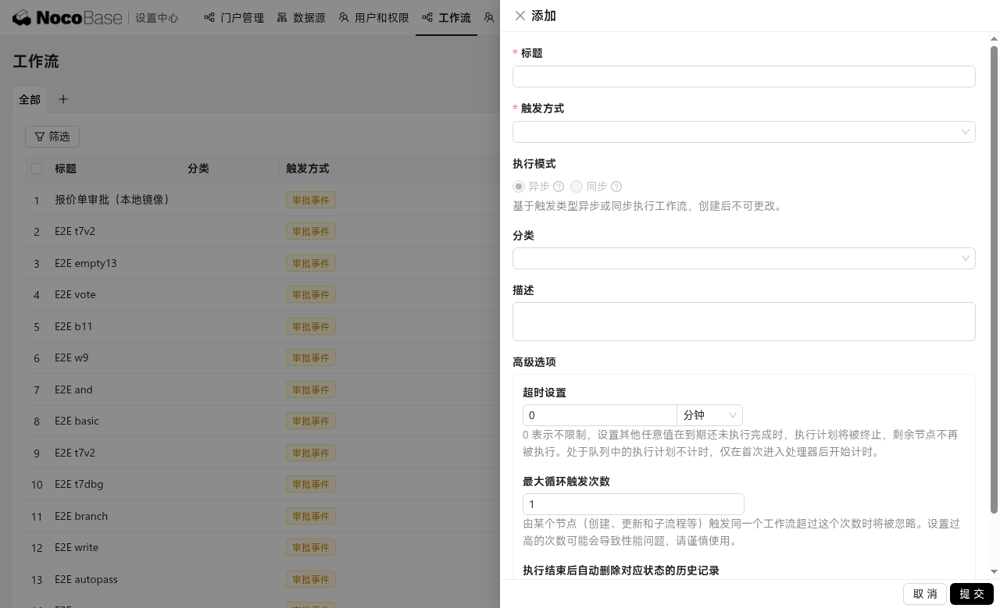 |

字段一致：标题 / 触发方式 / 执行模式（异步禁选联动）/ 分类 / 描述 / 高级选项（超时、最大循环触发次数、自动删除历史）。

### 步骤 2 · 触发方式下拉

| 官方 | 兼容实现 |
| --- | --- |
| !demo（本地归档，未随公开仓分发） | 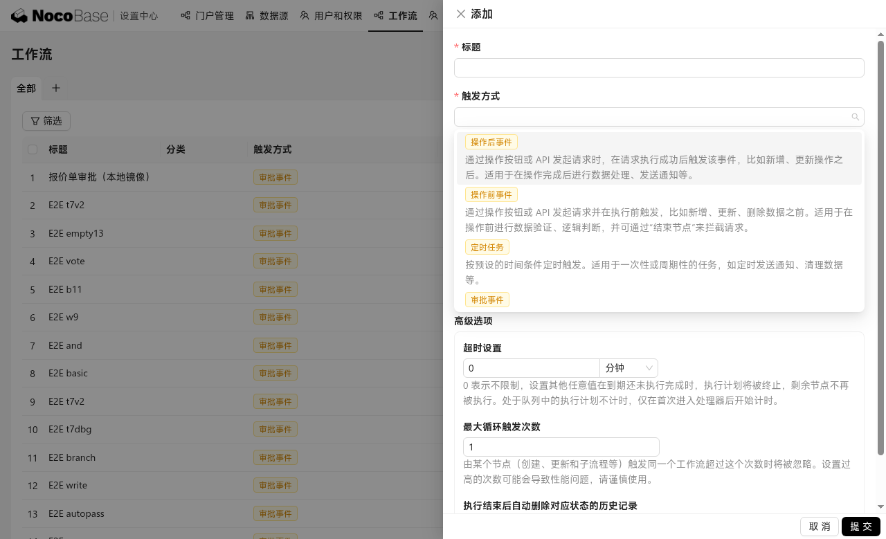 |

搜索框 + 卡片式选项列表（标签 + 描述），兼容实现选项集合 = 本地启用的触发器（少了 demo 独有的企业触发器，属环境差异）。

### 步骤 3 · 选「审批事件」→ 触发器配置（**数据表选择器，本次核心修复**）

| 官方（Trigger configuration + Collection 级联） | 兼容实现（触发器配置 + 数据表级联） |
| --- | --- |
| !demo（本地归档，未随公开仓分发） | 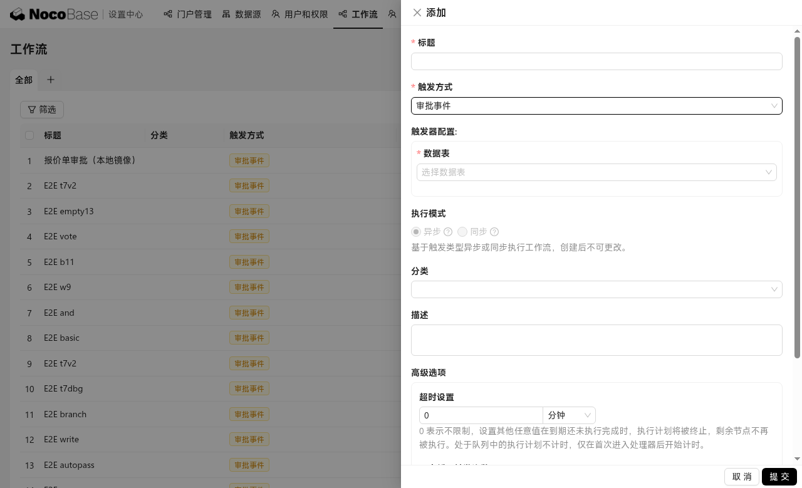 |

双方都渲染 `CollectionCascader`（必填）。级联第一级均为数据源：

| 官方（Main / External MariaDB / External PostgreSQL） | 兼容实现（主数据源） |
| --- | --- |
| !demo（本地归档，未随公开仓分发） | 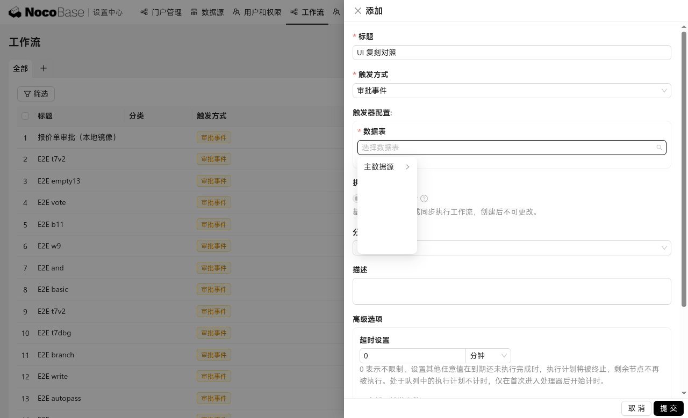 |

选中后官方显示 `Main / Tickets`，兼容实现显示 `主数据源 / t_kug56ojq1n2`（本地业务表）：

| 官方 | 兼容实现 |
| --- | --- |
| !demo（本地归档，未随公开仓分发） | （同 03 后选表，见 12 触发器面板） |

### 步骤 4 · 画布初始态

| 官方 | 兼容实现 |
| --- | --- |
| !demo（本地归档，未随公开仓分发） | 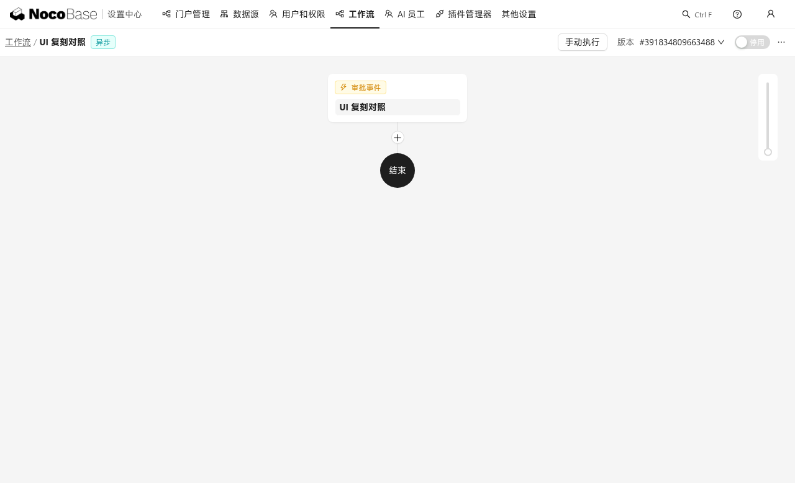 |

结构一致：触发器卡片（类型 chip + 标题）→ + → 结束圆点；顶栏 手动执行 / 版本号 / 启用开关。

### 步骤 5 · 加审批节点：类型选择抽屉 + 预设配置（模式）

实现侧类型选择抽屉与官方同为分组菜单（AI / 控制 / 计算 / 数据表操作 / 人工），审批位于「人工」组。
官方侧参考节点选择器截图（本地归档）；实现侧此处以预设弹窗为准：

| 官方（Add node · Mode） | 兼容实现（添加节点 · 模式） |
| --- | --- |
| !demo（本地归档，未随公开仓分发） | 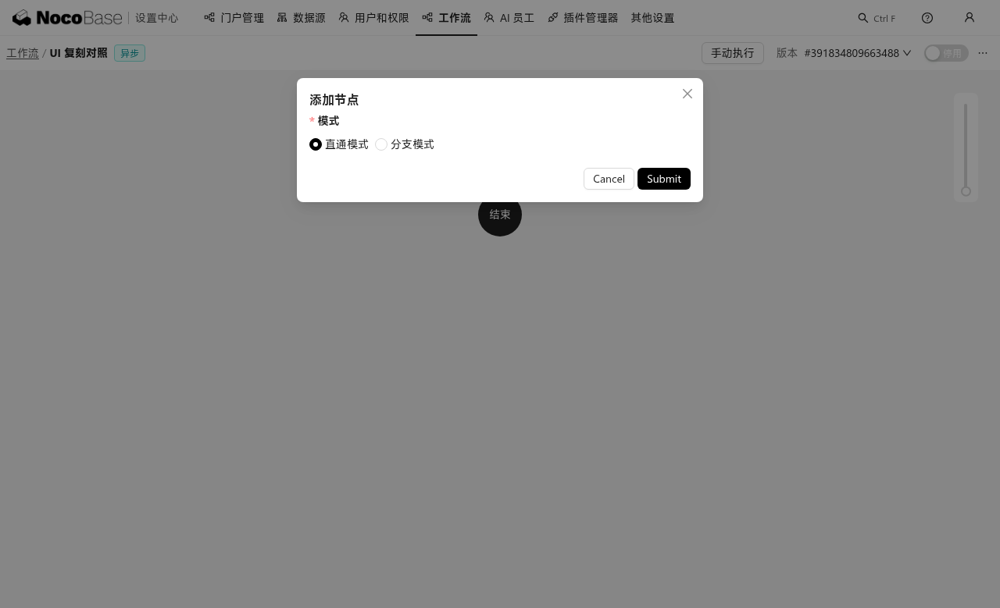 |

`直通模式(false) / 分支模式(true)` 单选一致；`createDefaultConfig` 均生成 `approvalUid`。

### 步骤 6 · 分支画布渲染（修复此前「泳道不渲染」差距）

| 官方（Rejected/Approved/Returned 三泳道，Returned 尾部终止符） | 兼容实现（拒绝/通过/退回，退回尾部终止符） |
| --- | --- |
| !demo（本地归档，未随公开仓分发） | 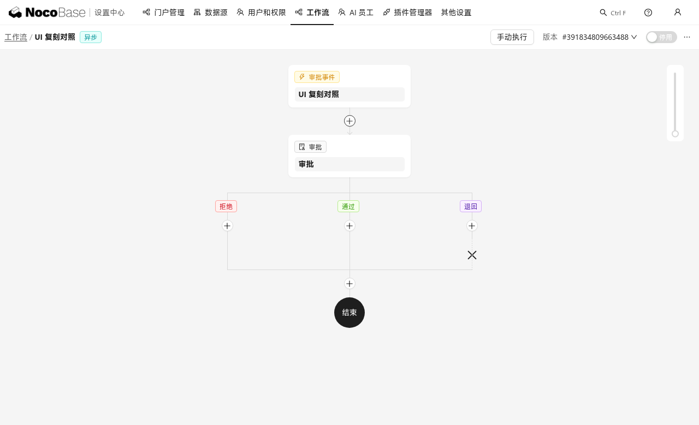 |

### 步骤 7 · 审批节点配置面板（FieldsetLoader 全表单）

| 官方 | 兼容实现 |
| --- | --- |
| !demo（本地归档，未随公开仓分发） | 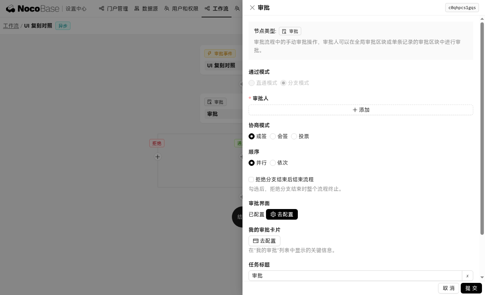 |

字段逐一对应：通过模式（禁用单选 + tooltip）/ *审批人（+ 添加 虚线按钮）/ 协商模式（或签·会签·投票）/ 顺序（并行·依次）/ 拒绝分支结束后结束流程 / 审批界面（去配置）/ 我的审批卡片（去配置）/ 任务标题（变量输入）。

### 步骤 8 · 审批人添加交互

| 官方（Popover：Select users / Query users） | 兼容实现（气泡卡：选择用户 / 查询用户） |
| --- | --- |
| !demo（本地归档，未随公开仓分发） | 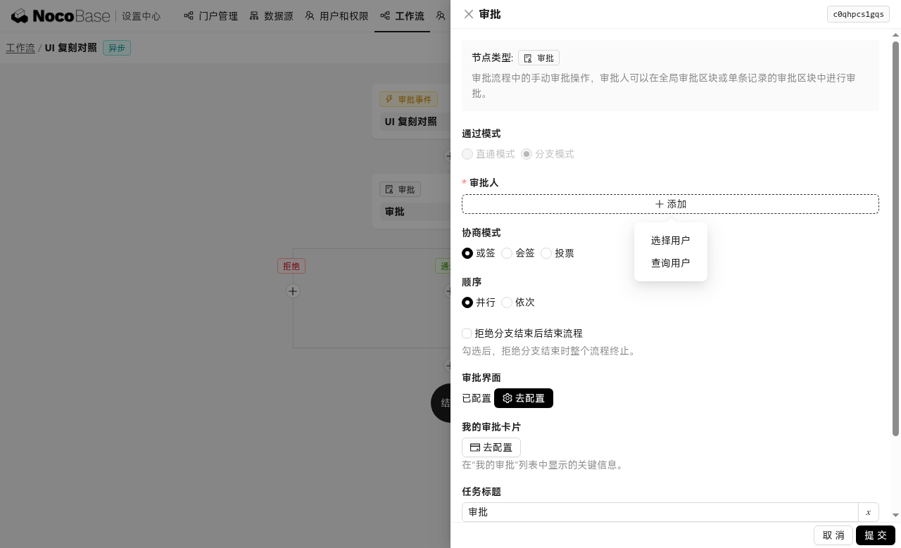 |

选中后行结构一致：拖拽柄 + 变量式用户选择器 + x + 删除：

| 官方 | 兼容实现 |
| --- | --- |
| !demo（本地归档，未随公开仓分发） | 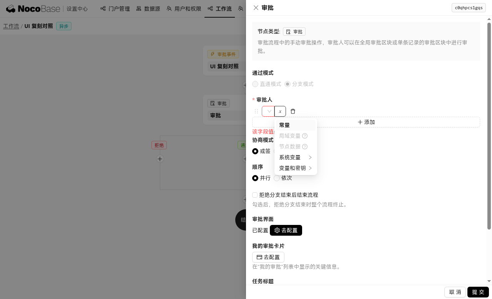 |

### 步骤 9 · 触发器配置面板（FieldsetLoader 全表单）

| 官方（上半） | 兼容实现（上半） |
| --- | --- |
| !demo（本地归档，未随公开仓分发） | 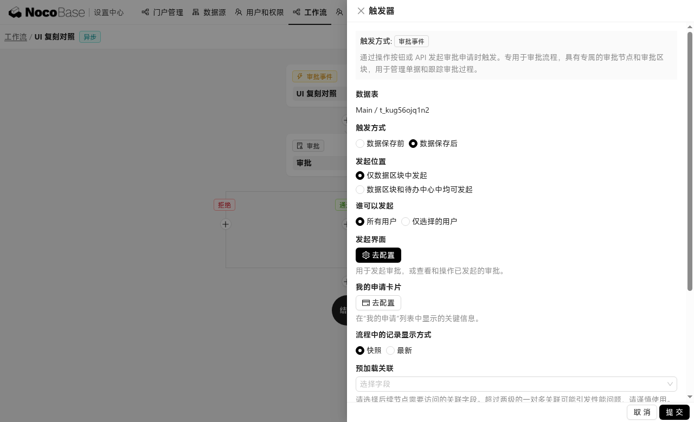 |

数据表只读显示（官方 `Main / Tickets`，兼容实现 `Main / t_kug56ojq1n2`）、触发方式、发起位置、谁可以发起、发起界面、我的申请卡片、流程中的记录显示方式、预加载关联。
下半（官方 13 vs 兼容实现同面板滚动）：

| 官方（下半） | 兼容实现（下半） |
| --- | --- |
| !demo（本地归档，未随公开仓分发） |  滚动后同构 |

### 步骤 10 · 手动执行（测试运行，触发器 TriggerFieldsetLoader）

| 官方 | 兼容实现 |
| --- | --- |
| !demo（本地归档，未随公开仓分发） | 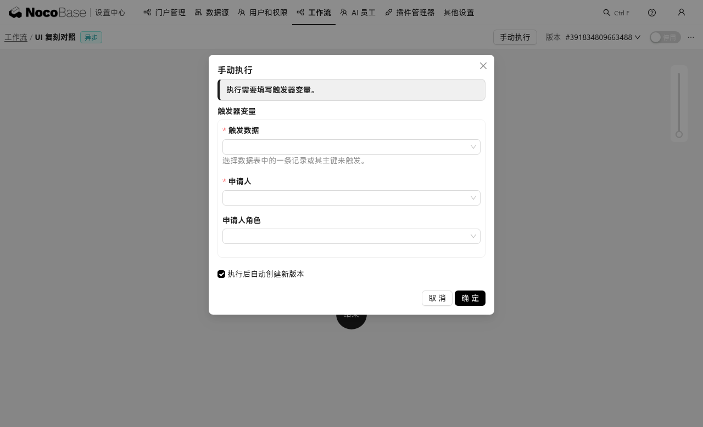 |

触发数据（记录选择）/ 申请人 / 申请人角色 + 「执行后自动创建新版本」。兼容实现为此补齐了服务端
`ApprovalTrigger.execute()`（官方契约：建审批 → 建轮次 → `workflow.trigger()` 返回 processor）。

### 步骤 11 · 执行后画布只读态（官方同款行为）

兼容实现执行过一次后出现官方同款黄条「已经执行过的工作流不能被修改…」，卡片变灰：

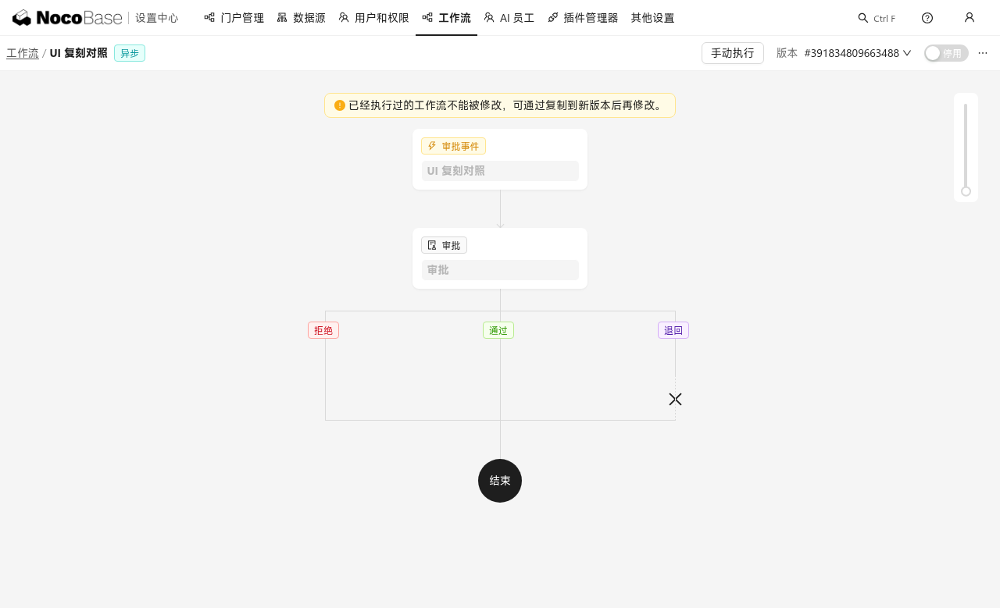

### 步骤 12 · 待办中心审批闭环（实现侧运行验证）

任务中心（15）→ 我的审批列表（16，新审批置顶「审批 · 待处理」）→ 任务卡（17：节点/状态/工作流/申请人/申请数据/审批记录 + 审批意见 + 通过/拒绝/退回/委派/加签）→ 点击通过 → 审批 status=4、记录 status=2、通过分支执行完毕。

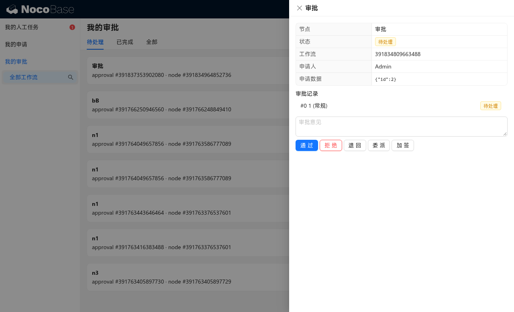

### 步骤 13 · 发起界面配置弹窗（首轮功能等价，已被 §5 的官方模型类复刻取代）

官方的「发起界面/审批界面」是 FlowEngine 界面搭建器。其私有模型类（`TriggerChildPageModel`、`ApprovalChildPageModel`、
`ApplyTaskCardDetailsModel`、`PatternFormBlockModel` 等）全部定义在公开下发的客户端分包里
（bundles 344/984/143/427/502/654/733/828），可直接解析复刻——并非依赖不可得。
首轮为控制范围，先做了「字段勾选 + 允许撤回」的功能等价实现（下图）；
第二轮已替换为按官方模型类的 1:1 复刻（见 §4）：

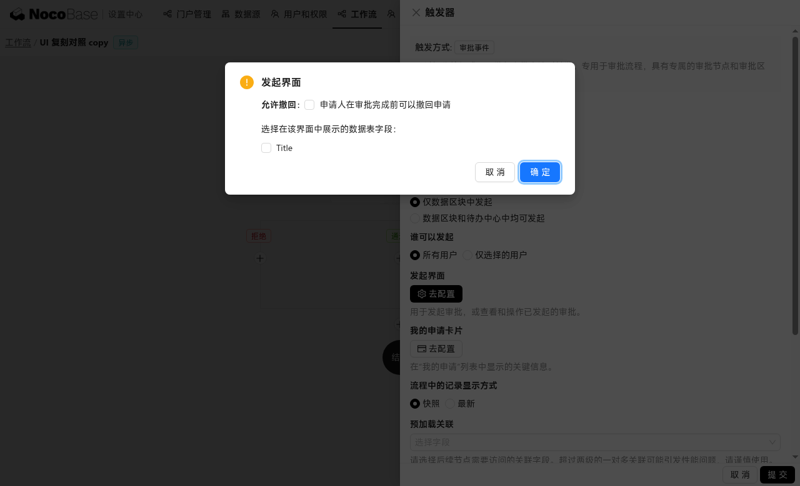

## 3. 本轮修复清单

| # | 问题 | 修复 |
| --- | --- | --- |
| 1 | UI 建流缺数据表选择器 → 运行失败 | 触发器/节点改 modern-loader 注册（`PresetFieldsetLoader`/`FieldsetLoader`/`ComponentLoader`/`TriggerFieldsetLoader`），新增 `src/client-v2/fieldsets.jsx` 复刻官方三块 chunk |
| 2 | 服务端 joi `mode` 必填，与官方（建流只存 collection）不符 | `mode` 改 optional，运行时 `?? 0` 兜底（index.js / actions.js） |
| 3 | 画布分支泳道不渲染（docs/06 已知差距） | 实现 `ApprovalCanvasComponent`（NodeDefaultView + Branch ×3） |
| 4 | 「手动执行」报 `"execute" method of trigger approval is not implemented` | 触发器实现 `execute()`：建审批+轮次 → `workflow.trigger()` |
| 5 | `VariableInput` 导出名错误（React #130） | 正确导出名为 `WorkflowVariableInput` |
| 6 | `@dnd-kit/*` 被 esbuild 内联 stub（`useSensor is not a function`） | build-umd.js 增加 `--external:@dnd-kit/*`，运行时由 RequireJS 注册表解析 |
| 7 | 测试运行表单 RemotePick 丢弃 Form.Item 注入的 value/onChange | 透传 value/onChange |
| 8 | 服务端 trigger configSchema 拒绝新配置键 | 增加 `usageInstructions/approvalUid/taskCardUid/applyFields/cardFields/associationShowMode` + `unknown(true)` |
| 9 | 触发器 `createDefaultConfig.centralized` 与官方默认不一致 | true → false |
| 10 | 界面配置弹窗字段列表为空 | fields 取值兼容 `data.fields` 与 `data.values.fields` 两种仓库形态 |

## 4. 第二轮：官方私有模型类 1:1 复刻（发起/审批界面搭建器）

官方界面搭建器的全部私有模型类定义在公开下发的客户端异步分包中（可直接解析，不存在"依赖不可得"），
本轮从各分包逐类 1:1 移植（保留官方命名、extends 链、flow 定义与默认参数）：

| 官方分包 | 复刻文件 | 模型类 |
| --- | --- | --- |
| chunk 502 | `src/client-v2/models/applyTaskCardModels.jsx` | `ApplyTaskCardDetailsModel/GridModel/DetailsItemModel/DetailsAssociationFieldGroupModel` + 虚拟 data/dataAfter 关联字段解析 |
| chunk 654 | `models/approvalDetailsModels.jsx` | `ApprovalDetailsModel/GridModel/ItemModel/AssociationFieldGroupModel`（extends workflow NodeDetails*） |
| chunk 344 + 984 | `models/triggerPageModels.jsx` | `TriggerChildPageModel/TabModel` + `TriggerBlockGridModel`（Add block 菜单：Form→Apply form、Other blocks） |
| chunk 143 + 427 | `models/approvalPageModels.jsx` | `ApprovalChildPageModel/TabModel`（ApprovalChildPageSettings flow）+ `ApprovalBlockGridModel`（审批区块/数据区块/其他区块菜单）+ ProcessForm 创建参数工厂 |
| chunk 733 | `models/approvalTaskCardModels.jsx` | `ApprovalTaskCardDetailsModel/GridModel/ItemModel/AssociationFieldGroupModel`（快照/最新记录策略、旧字段绑定迁移） |
| chunk 828 | `models/patternFormModels.jsx` | `PatternForm*` 九类 + `ApplyFormModel`（Submit/SaveDraft/Withdraw/Delete 动作）+ `ProcessFormModel`（Approve/Reject/Return/Delegate/AddAssignee 动作）+ `CommentForm*` 三类 + 完整 clickSettings 流程（确认/跳过必填/字段赋值/退回节点选择/加签顺序/委派对话框） |
| chunk 51 | `models/centerBlocks.jsx` | `ApprovalBlocksMenuModel/ApprovalTaskListBlockModel/ApprovalInitiationsBlockModel/ApprovalTodosBlockModel` |
| chunk 16 | `models/centerBlocks.jsx` | `RelatedApprovalsModel`（listRelated + dataKey 过滤） |
| chunk 524 | `models/centerBlocks.jsx` | `ApprovalTaskRouteDetailPageModel` |
| 主包 module 9813 | `models/registerModelLoaders.js` | `registerApprovalModelLoaders()`——45 个 extends+loader 注册项、`__workflowApprovalModelLoadersRegistered__` 守卫 |
| 主包 module 358/9488/8401 | `models/shared.js` + `models/zh-CN.js` | 命名空间/状态元数据表/MZ·kj 翻译助手/zh-CN 词条（第四轮起与官方 NS 词条全量对齐，另同步进 `dist/locale/` 由服务端下发） |

配置弹窗链路（chunk 483/617）同步移植到 `models/interfaceConfig.jsx`：
触发器侧 `config.approvalUid`（`TriggerChildPageModel` 树，前缀 `approval_`）与 `config.taskCardUid`
（`ApplyTaskCardDetailsModel` 树，前缀 `task_card_`）；节点侧同样两键（`ApprovalChildPageModel`/
`ApprovalTaskCardDetailsModel`），遗留 v1 `config.applyForm`/`applyDetail` 走官方同款
「配置新界面」迁移（`uiSchemas:remove` + workflows/flow_nodes:update）。

### 验证（本地与官方 demo 逐步对照）

1. 触发器「去配置」→ 弹窗渲染 `TriggerChildPageModel` 树（添加区块虚线按钮）：
   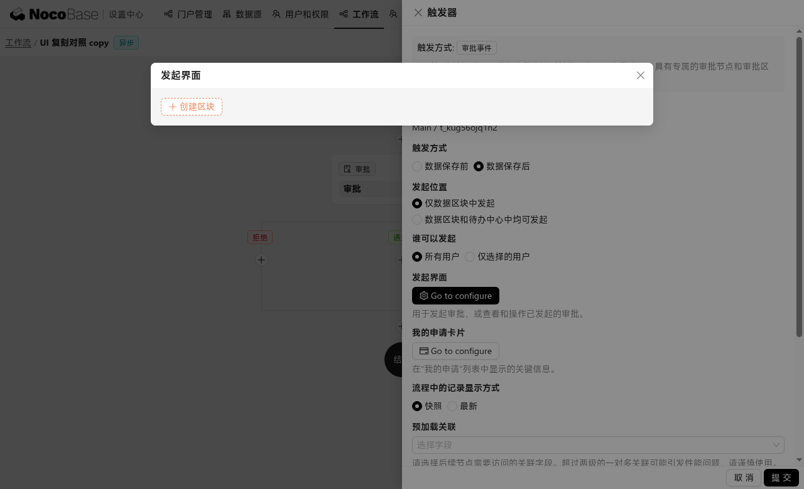
2. 添加「申请表单」→ `ApplyFormModel` 配置态：字段 / Submit / 操作 / 创建区块：
   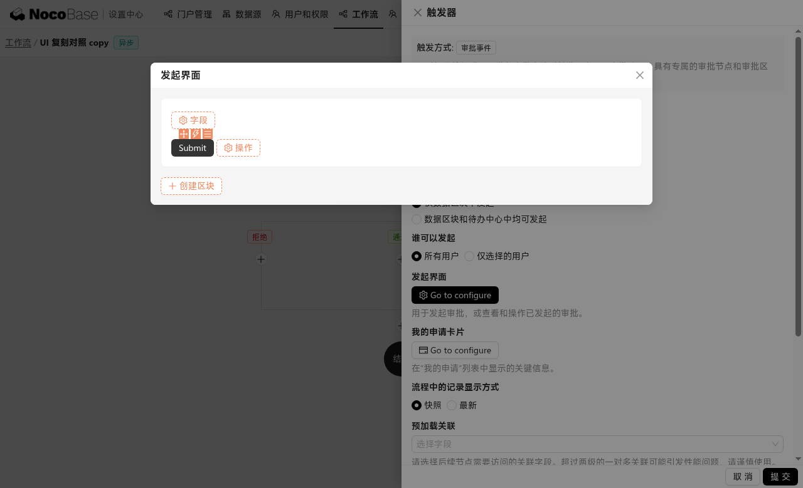
3. 「字段」菜单 = 显示字段（业务表字段 toggle）+ 其他（JS field/JS item/Divider/Markdown）：
   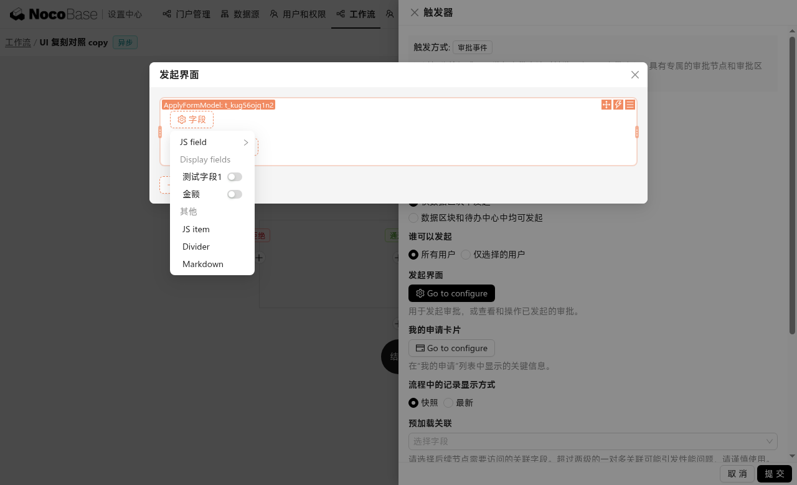
4. 勾选字段 → `PatternFormItemModel` 表单项渲染进表单：
   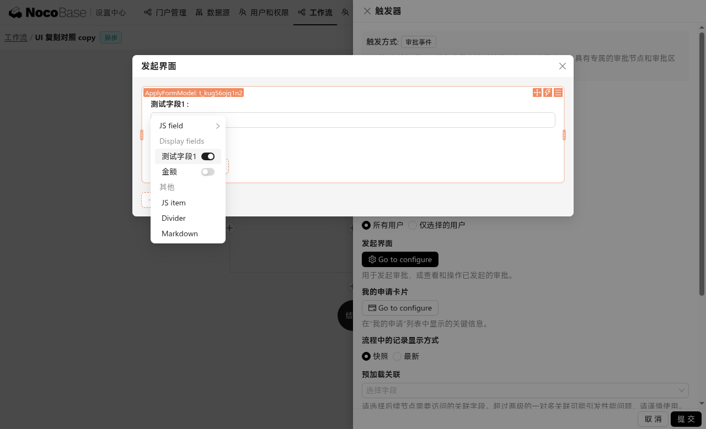
5. 提交后 `config.approvalUid = approval_xxx`（官方同款前缀格式）持久化；重开弹窗恢复已搭建界面。
6. 节点「审批界面」→ `ApprovalChildPageModel` + `ApprovalBlockGridModel` 菜单（审批区块→审批表单 /
   数据区块→Triggers / 其他区块）+ `ProcessFormModel`（字段/操作/创建区块）：
   
7. 「操作」菜单添加通过动作 → `ProcessFormApproveModel`（官方 afterAdd 链含 comment 模型 ensure）：
   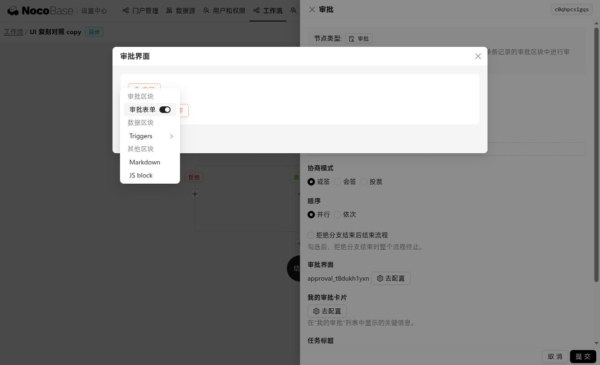
8. 重开弹窗从服务端 `flowModels:findOne/save` 完整恢复；节点 `config.approvalUid` 持久化、`applyDetail=null`（无遗留界面）。
9. 官方 demo 同操作对照：按钮布局（Fields/Actions/Add block 三段式）、菜单结构、交互行为一致（官方点击 Actions 的表现与兼容实现相同）。
10. 「我的申请卡片」：弹窗渲染 `ApplyTaskCardDetailsModel` 卡片（标题=工作流名），「字段」菜单与官方同构
    （审批信息：ID/状态/创建日期/最后修改日期 + 显示关联字段：工作流/审批数据 + Others）：
    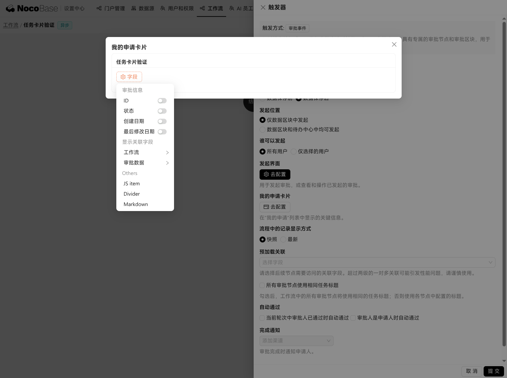

## 5. 第三轮修复（用户反馈回归）

| # | 反馈 | 结论 / 修复 |
| --- | --- | --- |
| 1 | 分支泳道不能添加节点（+ 按钮缺失） | 非缺陷："+" 的显隐由 workflow 核心按 `versionStats.executed` 控制（官方 chunk `S8`）。双端实测：**未执行工作流兼容实现与官方均显示 5 个 +**（三泳道各一 + 触发器下 + 汇合后一）；**执行一次后两端 + 全部隐藏**（官方同款只读锁定）。用户对比的兼容实现工作流是已执行版本，官方截图取自未执行版本。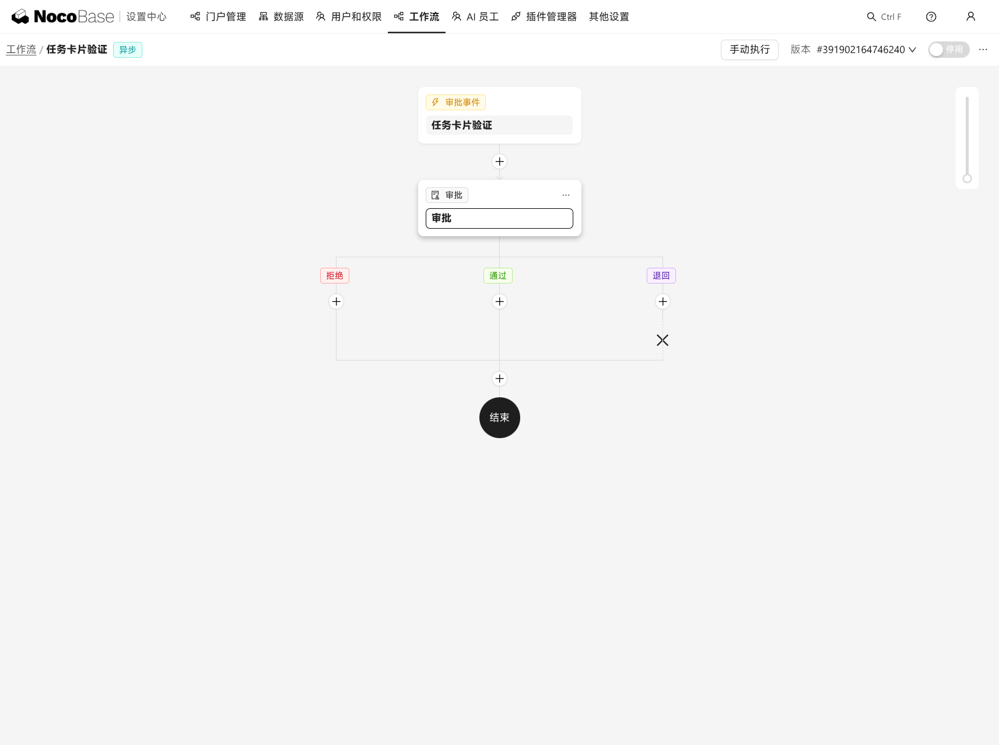 |
| 2 | 审批人用户选择器 | 按指示照搬 CC 抄送所用选择器：`@nocobase/plugin-notification-manager/client-v2` 的 `UserSelect`（CC 行组件同款，内部为 workflow `UsersSelect` 的 nullable 包装）。行内显示昵称（Admin）、提交持久化 `config.assignees=[1]` 验证通过。 |
| 3 | 「我的申请卡片」报“数据表 主数据源 > approvals 可能已被删除” | 根因：官方主包 module 334 的 `registerCollections`（客户端集合 schema 注册）在首轮移植时被实现为空函数，客户端 main 数据源里没有 approvals/approvalRecords 等集合。已 1:1 补齐 `models/registerCollections.js`（workflows/flow_nodes 摘要 + approvals 16 字段 + approvalRecords/approvalExecutions/approvalMsgTpls/approvalAudiences/approvalAudienceUsers 全量，含 uiSchema/枚举/indexes，注册时统一 hidden），并在插件 load 与 `dataSource:loaded` 事件（官方 handleDataSourceLoaded）挂接。修复后卡片渲染与字段菜单同官方。 |

## 6. 第四轮修复（任务中心审批时间线）

用户反馈「任务中心的 timeline 呢？」——官方任务详情弹窗右侧的审批过程时间线（`发起 → 审批节点`，
圆点状态图标 + 处理人头像 + 状态徽标 + 时间戳/耗时 + 转签/加签行 + 意见引用块）在兼容实现里此前是
紧凑「审批记录」列表。本轮按官方私有实现 1:1 补齐：

| 官方模块 | 复刻位置 | 内容 |
| --- | --- | --- |
| module 7781 | `src/client-v2/models/approvalTimeline.jsx` | `ApprovalTimeline`（ea）/ `ApprovalTimelineActionCard`（xY）：rounds→jobs→records 三层聚合（`q` 的 ADDED/DELEGATED 挂接、job 桶按 jobId 归并、`H` 的 execution.jobs 兜底、无 records 单记录回退）、`J` 稳定 key、FNV-1a 头像配色、20×20 圆点（`A` 图标表）、会签/投票/或签 pill（`Y`）、`<time>` 时间戳、job 耗时（dayjs relativeTime，内联移植插件）、撤回条目（-4）与终止条目（execution FAILED/ABORTED → System + reason） |
| module 2062 | 同上 `TaskApprovalTimeline` | 任务中心包装（compile/formatDateTime/getExecutionReasonLabel→workflow ns） |
| module 9488 ws/kj + 7886 | 同上 | `[NS,'client']` nsMode fallback 翻译 hook、`YYYY-MM-DD HH:mm:ss` 格式化 |
| module 3557 eD | `index.jsx TaskDetailLayout` | 桌面 Row/Col 左内容右时间线（lg 60/40、xl 70/30，gutter=margin）、窄屏 Tabs「审批 / 审批过程」 |

配套修正（对照官方契约）：

1. **getPopupRecord 返回壳**：任务中心页期望 `e.data.data`（APIClient 形状）自行 setRecord；
   兼容实现此前解包成裸 record，导致 URL 直达 `/admin/workflow/tasks/<type>/pending/<id>` 弹窗不渲染。
2. **Item 点击行为**：官方 Item 是「跳转 popup 路由 → 页面弹 Modal」，兼容实现此前自己开 Drawer——已改为 `navigate(...)`。
3. **服务端 appends**：`approvals:get` 默认 appends 改为官方 `Z` 清单；`decorateRecord` 按 `ee`
   补齐 `approval.records.job/node/user`、`approval.latestRound.execution.jobs`、`workflow(.nodes)`、record 级 `job`。
4. **集合关联**：`approvalExecutions` 补 `belongsTo execution`（`latestRound.execution.jobs` 依赖，核心 executions 已有 hasMany jobs）。
5. **round 状态**：`onExecutionStatusChange` 跳过 STARTED/null（官方 round 进行中保持 null；此前 null 被 `Number()` 归 0 写库）。
6. **zh-CN 词条**：与官方 364 条 NS 词条全量对齐（现 391 条，状态用词取官方：通过/否决/退回/转签至/加签/耗时/审批过程等）。

验证（DOM 度量，截图通道冻结）：

- 我的审批弹窗：`发起`(发起成功点) + `n1`(待处理点/或签 pill/20 小时耗时)，记录行
  `Admin[已转签]+时间`、`转签至: Admin`、`Admin[待处理]`、`加签: Admin` 全部渲染；
  双栏 751px + 322px（60/40），Modal large（1096px）。
- 我的申请弹窗：`发起` + `n1`（或签/几秒），`Admin[否决]+时间` + 意见引用块。
- 草稿（无 rounds）不渲染时间线——与官方 `ea` 返回 null 一致。

## 7. 第四轮修复（任务弹窗专项 + 全量审计，2026-10-14）

用户反馈「modal 弹出逻辑有差异」后开展全量语义审计（方法学与台账见 [docs/09](09-ui-full-audit.md)）：

| # | 差异 | 修复 / 定性 |
| --- | --- | --- |
| 1 | 双弹层叠现（Drawer+Modal） | 旧构建行为，后续构建不复现；硬刷新即消 |
| 2 | 弹窗列宽 xl 70/30、gutter 8 | 官方 DOM 实测 **64/36 + gutter 16**，已改（双端 style 串一致） |
| 3 | 退回场景时间线 dot 恒金 | 官方写**核心 job 状态**（1/-5/-6）；服务端 onRecordActed/returnToNode 补写，dot 与官方同色同语义 |
| 4 | 审批意见 `[object Object]` | comment 列 text→jsonb（DB 已迁移）+ 三处对象感知渲染 |
| 5 | Modal body 微横溢 | 官方同款行为，不修（误判澄清） |
| 6 | 弹窗左列结构（官方=业务记录卡+状态卡+Apply 卡+当前节点卡；列表卡=任务卡字段栅格） | 新增 `models/taskDetailCards.jsx` 全套渲染器，弹窗四卡/列表卡与官方 DOM dump 同构；JSItem 沙箱块为范围取舍 |
| 7 | 退回/通过时未动审批人 record 状态 | 官方铁证：退回→其余 3(UNPROCESSED)、通过→其余保持 0(PENDING)；stampRemainders 修正，或签双审批人回归逐值命中 |
| 8 | 节点配置抽屉「审批界面」行多显 uid | hideUid 默认 true，与官方一致（仅「进入配置」按钮） |
| 9 | 分支画布点卡任意处开配置（官方 alpha.10 行为） | ApprovalCanvasComponent capture 转发 chip；分支节点已验证，非分支节点宿主不挂 ComponentLoader（宿主行为） |
| 10 | 抽屉标题拼 node key / 任务中心菜单分组 / Apply new / Print | 宿主 alpha.9 帧行为（插件 bundle SHA 双版一致铁证）→ 版本偏移，跟随宿主 |

## 8. 仍与官方有差距（记录在案）

1. ~~发起/审批界面搭建器~~：已在第二轮按官方私有模型类 1:1 复刻（见 §4）。模型类语义完整；官方 chunk51/524 的重型列表/详情页组件库（module 3557）以紧凑 antd 等价呈现（模型类语义 1:1，渲染皮肤简化——范围取舍，非不可行）。任务中心**时间线**已于第四轮按 module 7781 1:1 补齐（见 §6）。
2. **数据区块发起动作**：官方在集合区块提供绑定审批工作流的「发起审批」按钮（走 workflow 核心动作绑定体系）；兼容实现发起走 API / 后续可挂自定义按钮。
3. ~~通知渠道~~：已于第五轮全链路接通（见 §9）——节点 todo 组/触发器 done 组 fieldset、approvalMsgTpls 模板 RemoteSelect、Custom 编辑器、服务端发送链与内置种子全部与官方 wire 对齐。
4. **audienceType 强制**：官方服务端校验「谁可以发起」；兼容实现目前 UI 可配置（approvalAudiences 读写已实现），服务端暂不强制。
5. **i18n**：已注册 391 条 zh-CN 词条（`dist/locale/` 服务端下发 + 客户端兜底，与官方 NS 词条对齐）；`lm-flow-engine` 命名空间的少数字符串（确认弹窗标题等）仍可能回落英文。
6. **任务弹窗标题/打印**：官方 DetailModal 标题带工作流名 + Print 按钮（module 3557 ek/eM）；兼容实现弹窗外壳由本地 alpha.9 任务中心页提供（无 Print）。

## 9. 第五轮：站内信通知渠道全链路（双端实测，2026-10-14）

官方语义（alpha.10 demo wire 取证 + chunk-931/483/617 反汇编）：

- **挂载点**：审批**节点** `config.notifications` = **todo 组**（"审批待办分配时通知审批人"，变量集 LY）；审批**触发器** `config.notifications` = **done 组**（"审批完成时通知申请人"，变量集 N5）。同一组件 module 1242（NotificationList）。
- **行结构**：渠道 Select（**禁用**，flex 0 0 12em，选项来自 `notificationChannels:list`）→ templateType Select（`N4`：模板 template/自定义 custom，切换清空 template）→ 模板字段（custom→「配置模板」弹窗编辑 `{title,content,options:{url,mobileUrl,duration}}`；template→RemoteSelect 拉 `approvalMsgTpls:list?filter={notificationType,type}`）→ 删除按钮。列表下方「Add channel」Select（placeholder，选中即加行 `{channel, templateType:'template'}`）+ 组说明文字。
- **模板集合**：`approvalMsgTpls = {id(snowflake), notificationType, title, type:'todo'|'done', template:{title,content}}`；官方安装种两条内置模板（Approval todo/Approval done，Handlebars 变量 `{{approval.workflowTitle}}/{{approval.approvalId}}/{{approval.nodeTitle}}/{{applicant.nickname}}/{{statusText}}`）与一条内置渠道 `approval-todo-in-app-message`（meta editable:true/deletable:false）。
- **发送**：approval 服务端 → notification-manager `send({channelName, message, data, receivers:{type:'userId',value:[…]}, triggerFrom:'approval', transaction})` → in-app 渠道落 `notificationInAppMessages`（unread）+ `notificationSendLogs` + ws 推送；`statusText` 观测值 "Approved"（英文）。

兼容实现：

- 服务端 `dist/server/notifications.js`：sendTodo（instruction.run 节点入口 + 顺序门控开位）/ sendDone（onExecutionStatusChange 终态 APPROVED/REJECTED/RETURNED，按官方选项文案三态）；`afterStart` 幂等种内置渠道 + 双模板（type/notificationType/template 与官方逐字段一致）。
- 客户端 `src/client-v2/models/notificationsFieldset.jsx`：NotificationList/TemplateField/ConfigureTemplateButton/InAppTemplateFields + LY/N5 变量集；接入触发器（done）与节点（todo）fieldset，替换占位 Select。
- alpha.9 宿主兼容：antd 5.6 无 Flex/Space.Compact/ConfigProvider.useConfig（div+样式、可选链兜底）；RemoteSelect 取自 `@nocobase/client-v2`（workflow 包不导出）；FlowContextSelector 宿主 flow-engine 自带。

双端实测（各自建渠道 `re_verify_in_app` + lab 工作流「RE notify lab」+ 集合 t_renotify，submit→approve）：

| 验证点 | 官方 demo (alpha.10) | 本地兼容实现 (alpha.9) |
| --- | --- | --- |
| 建渠道 notificationChannels:create | ✅ | ✅ |
| TODO 消息（节点 todo 模板） | ✅ `Approval todo: RE notify lab (#…)` / `* Task: RE approval\n* Applicant: Super admin` | ✅ 同格式（Applicant: Admin） |
| DONE 消息（触发器 done 模板） | ✅ `Approval done: …` / `* Result: Approved` | ✅ 逐字节一致 |
| 消息路由到自建渠道 | ✅ channelName=re_verify_in_app | ✅ |
| notificationSendLogs | demo 列表受 ACL 限制 | ✅ status=success ×2（triggerFrom=approval） |
| 已读（updateMyOwn+filterByTk）/未读计数 | ✅ | ✅ count 2→1 |
| 抽屉渲染/加渠道/Custom 编辑器/变量树 | 官方基线 | ✅ 与官方同构（截图比对） |
| workflows:update 持久化 notifications | ✅ | ✅（不复现 taskCardUid 吞键问题） |

剩余差异（范围取舍）：Custom 编辑器变量树合并逻辑按官方语义简化实现（approval 组 + 宿主工作流变量 + $context/$system，name 去重）；非 in-app 渠道的 ContentConfigForm 依赖宿主 notification-manager client-v2 导出（本地已有）。

Demo lab 清理：工作流「RE notify lab」已禁用并删除、集合 t_renotify 已删（遵守不触碰 demo 业务数据约定）；渠道 `re_verify_in_app` 保留作验证证据（两条验证消息留在 admin 收件箱）。

## 9.5 任务中心「发起新申请」（2026-10-14，用户报告缺失后补齐）

官方实现（module 9095 `eL` + 页面注册 `eQ`）：「我的申请」Actions 槽 = [刷新 eI / 筛选 ej / 发起新申请 eL]；按钮 → Drawer（`workflows:listApprovalFlows`，filter `config.centralized:true`，pageSize 20，sort -createdAt；筛选 CollectionFilter[workflows: id/title/createdBy] + 刷新；卡片=标题+(usageInstructions‖「点击发起审批」)+右箭头，invalid 感叹号，不可点条件 `invalid‖无 approvalUid 且无 applyForm`）→ Modal(800, footer null, 标题=工作流名) 按 `config.approvalUid` 渲染发起界面（可编辑表单+树内 Submit；旧版 applyForm→Result 提示回旧页；未配置→Result）。

兼容实现端落地：
- **挂载点**：alpha.9 宿主 v1 任务页本身渲染 `taskType.Actions`（tabBarExtraContent 右侧，桌面无 props、移动端 `{onlyIcon}`）——此前 D-6「Apply new 缺失=宿主行为」结论修正：宿主有槽，兼容实现 taskType 没提供 Actions。
- **服务端**：`workflows:listApprovalFlows`（registerActionHandler + loggedIn ACL）= type approval + enabled + current + config.centralized + 用户 filter，{rows,count} 由 data-wrapping 包成官方线格式 {data, meta:{count}}。
- **客户端** `models/applyNew.jsx`：按钮/Drawer/卡片/分页(>20)/invalid/紧凑筛选(名称 $includes + ID)/刷新；Modal 紧凑表单（D-3 先例：任务中心页无 FlowContext，走 flowModels 树提取 ApplyFormModel→grid→items 的 fieldPath 渲染 antd 编辑器，Submit→`approvals:create {collectionName, workflowId, data, status:2}`→关闭+刷新）；FieldEditor 透传 Form.Item value/onChange（首个版本漏透传=失控输入框，E2E 抓出）。
- **服务端语义修正（官方截图铁证）**：mode=0 提交时官方把提交数据写入业务记录（demo 提交态记录就有全部值），原「空壳记录」实现丢弃 data——已改为建壳后立即写入提交数据，终审仍按 lastResult/approval.data 重写。
- **页面级刷新/筛选（eI/ej，已实现）**：Actions=Space[刷新,筛选,发起新申请]（todos 页官方只有前两个）。官方契约：ej 把筛选 JSON 写入 URL 参数（apply=`workflowApprovalApplicationsFilter`，todos=`workflowApprovalTodosFilter`）并调宿主 reload 通道；useActionParams 以 `eu(基础过滤, workflowKey, ei(filterKey))` 三层合并。alpha.9 宿主不传 reload 通道→刷新=整页刷新、筛选=写 URL 后整页刷新（范围取舍）；useActionParams 已按官方合并 workflowKey（宿主第二参）与 URL filter。筛选面板为紧凑 Popover（申请页：状态多选+申请时间范围；审批页：处理状态/审批状态/创建时间）替代宿主 CollectionFilter（范围取舍）。E2E：待处理 tab+已通过=空（官方同款 AND 语义）、已完成 tab+已通过=38 条全通过、todos approval.status=[2] 收窄 13→10、重置清参数、刷新重载。
- **盘点补漏（同轮）**：useActionParams 此前忽略宿主第二参 workflowKey（左侧栏工作流筛选通道）——已按官方合并（apply=`{workflowKey}`、todos=`{'workflow.key'}`）；本地侧栏无每工作流列表+计数=alpha.10 宿主页 UI，alpha.9 宿主差异（非兼容实现范围）。
- 其余范围取舍：抽屉筛选为紧凑 Popover 非宿主 CollectionFilter；发起界面为紧凑表单非 FlowModelRenderer（无 FlowContext）；旧版 applyForm 的「返回旧版页面」在本地即当前页。
- E2E（RE chain lab，已配 approvalUid 申请表单+title 字段+centralized+enabled）：按钮→抽屉（47 条分 3 页）→卡片→Modal→填 title→提交：status=2 且 t_renotify#5 title 即时落库；两轮审批后 status=4、approval.data 与记录均含 title；筛选「RE chain」精确过滤 1 条。lab 保留作回归 fixture。

## 9.6 站内信通知多用户实测（2026-10-14，新渠道 + 测试账户）

测试资产（保留作回归 fixture）：账户 张申请(id3/reapplicant)、王审批一(id4/reapprover1)、李审批二(id2/reapprover2)，密码 <user-test-password>；新渠道 `re_multi_channel`（in-app-message，X-Role: root 头创建）；工作流 RE notify multi(392071042498560，t_renotify、centralized、enabled，节点=王审批一+李审批二 会签，节点/触发器 notifications 均绑新渠道 custom 模板)。

实测矩阵（API 逐人验证）：
1. 张申请经 approvals:create 提交 → 王审批一/李审批二 各收 1 条 unread todo，内容=「申请人 张申请 的单据 #N 等待处理（RE multi channel）」变量渲染正确；张申请 0 条（申请人不收 todo）✓
2. 双审批人先后 approve → approval status=4 → 张申请收 1 条 unread done：「审批完成：RE notify multi」/「单据 #8 结果 Approved」（workflowTitle/dataKey/statusText 渲染正确）；审批人无 done ✓
3. 逐人 myInAppMessages:list 隔离（各自只见自己的消息）+ unread count ✓

**修复的 bug（用户报告前主动发现）**：sendTodo 申请人昵称渲染成 Admin——`users` 仓库 `filterByTk: 3` 返回了 user 1（本环境 users 仓库 findByTk 错行怪癖，debug 日志实锤 `createdById=3 user=1/Admin`）；改为 `filter: {id}` 后正确。**教训：本环境 users 仓库查行一律用 filter:{id}，勿用 filterByTk**。

**环境坑**：纯 `nb app restart` 会重置 storage/dist-client 静态快照（client-v2 404 白屏）——服务端文件变更后必须跑 dev-restart.sh（或至少补快照拷贝步骤）。

**登录问题归因修正（2026-10-14，用户质疑后 demo 复现）**：此前「测试账户 UI 登录被宿主登录流卡住（temp token 循环）」的结论**错误**。demo 实测：①官方 `users:create` **自动绑默认角色 member**（本地 API 创建不绑——差异点，但非弹回根因）；②signIn 返回 temp:true 两端一致（admin 可用 token 同样 temp，temp 非拦截点）；③member 角色 snippets（!ui.*/!pm.*）两端逐字节一致（官方默认）。**真因**：浏览器 localStorage 缓存的 `NOCOBASE_ROLE`（admin 会话残留 'root'）在登录新账户后仍被客户端用作 X-Role 头 → auth:check 401 `ROLE_NOT_FOUND_FOR_USER` → 弹回登录页。修法：登录时同步设置 token+`NOCOBASE_ROLE`（或 UI 内正常切换账户走客户端自身流程）。修复后：三个测试账户已绑 admin 角色，王审批一 UI 登录成功，铃铛角标=3，消息中心正确展示「多用户通知测试渠道」分组与 #8（张申请）/#7/#6 消息详情（截图存证 screenshots/audit-local 逻辑见 tools/record-cdp.mjs 管线外的手工截图）。

## 10. 工程规范化与 beta1 发布（2026-10-14）

对照 nocobase-plugin-development skill 的标准插件工程形态，把兼容实现从「dist 即源码、目录拷贝部署」规范化为「src 为源、dist 全部构建生成、标准包文件齐全、tgz 可发布」，并完成首个 beta 发布。

**结构变更**：
- `dist/server/**`（7 个 CJS + collections/×6）与 `dist/locale/*.json` 原样归位 `src/server/`、`src/locale/`（服务端此前只有 dist 产物、无 src 源，是最大结构缺口）
- 新增 `scripts/build.js` 统一编排：client-v2/client 两条 UMD lane（build-umd.js 移入 scripts/）+ server/locale 原样拷贝 + 产物完整性校验（17 个文件存在 + server 入口可 require）；package.json scripts 增加 build/build:client/build:client-v2/build:server/clean
- `dev-restart.sh` 改为调用 `npm run build` 后部署，部署机制不变（node_modules 拷贝 + dist-client 快照重建）
- 插件目录内的 `storage/logs/`（应用日志取证）移至项目根 `evidence/logs/`

**包元数据**：version `2.4.0-alpha.9.local.1` → `1.0.0-beta.1`（兼容实现独立版本线，宿主兼容性由 peerDependencies 表达）；新增 files 白名单（dist + 3 个入口 stub + README/CHANGELOG/LICENSE）；补 README（clean-room 免责声明/安装/功能清单/已知差异索引）、LICENSE（AGPL-3.0 全文，取自 gnu.org——注意官方 @nocobase/plugin-workflow 包声明为 Apache-2.0）、CHANGELOG、插件级 .gitignore。包名保留与官方同名（兼容实现部署机制的前提，README 明示勿混装）。

**beta1 验证（全部通过）**：
1. clean build：删 dist → `npm run build` → 产物齐全、verbatim 拷贝逐字节一致、完整性校验通过
2. dev-restart 部署 → 静态资源 curl 200 → pm:list 注册 version=1.0.0-beta.1
3. E2E 冒烟（fixture RE notify multi 392071042498560）：reapplicant 发起（mode 0 直接提交，快照值随单）→ 王审批一/李审批二 会签（两笔 approvalRecords:submit）→ approval status=4 → 申请人 myInAppMessages unread 1→2，最新消息「审批完成：RE notify multi / 单据 #9 结果 Approved」（custom 模板 Handlebars 渲染正确）
4. 发布物：`npm pack` → `artifacts/nocobase-plugin-workflow-approval-1.0.0-beta.1.tgz`（24 文件 117KB，与工作区逐字节 diff 一致，src/scripts 正确排除）→ `nb plugin import` 接受并解包到 storage/plugins（内容逐字节一致）——**验证后已删除该副本**：开发环境依赖 node_modules+快照双拷贝机制，storage/plugins 会形成第三份遮蔽拷贝，导致后续 dev-restart 变更被旧文件盖住；正式环境安装才走 storage/plugins

**版本管理**：项目根 git init（main 分支，根 .gitignore 排除 node_modules/*.tgz/*.log/analysis（可由 bundles 再生成）/storage），initial commit `9c8e997`（195 文件），tag `v1.0.0-beta.1`。

### 10.1 依赖兼容性检查修复（2026-10-14，用户截图报告后）

用户在插件管理器「依赖兼容性检查」页报告：失败 banner「插件兼容性检查失败…」但表格「暂无数据」。定位（宿主源码 @nocobase/server/lib/plugin-manager/utils.js）：

- **检查机制与 package.json 无关**（读的是 `dist/externalVersion.js`）：部署包有 `src/` 时扫源码 import 提取外部包；无 `src/`（npm/tgz 安装形态，我们与官方一致）时读插件包的 `dist/externalVersion.js`（{包根: 版本} 快照）——**缺失即 `isCompatible:false, depsCompatible:[]`**，正是截图形态。
- 官方插件 package.json 同样只有 `peerDependencies` 没有 `dependencies`（对照 plugin-workflow 实包确认）——我们与官方在这层本来就一致，缺口纯粹是构建产物。externalVersion.js 由官方 build 管线自动生成（构建机版本快照），自研构建需自己补。
- 逐行判定：快照中每个包查宿主全局 deps 表（plugin-manager/deps.js，46 项：@nocobase→2.4.x、react→18.x、antd→5.x、react-i18next→11.x 等；scope 名命中规则 `deps[名] || deps[scope]`），`semver.satisfies(快照版本, 表范围, {includePrerelease:true})`，不在表内的包跳过不产出行，every 通过才 isCompatible:true。

修复：scripts/build.js 新增生成步骤——扫描 src/**/*.{js,jsx} 的 require/import 提取包根（20 个），版本本机解析优先（node_modules symlink→宿主源码树；注意 @dnd-kit/core 本机 package.json 的 version 字段异常返回 undefined，需类型校验后落快照兜底）、官方同宿主 externalVersion 快照兜底（react 18.2.0/antd 5.24.2/react-i18next 11.18.6 等客户端包不在宿主 npm 树，只能走官方快照）。dev-restart 部署后 `pm:get` 实测：isCompatible:true、20 行全 ✓（@nocobase/* 2.4.0-alpha.9 satisfies 2.4.x includePrerelease、joi 17.13.8 satisfies 17.x 等）；E2E 冒烟（发起→待办生成→双审批人拒绝终结）确认链路不受影响；tgz 重打包 25 文件含 externalVersion.js。

### 10.2 干净环境安装验证（2026-10-14，beta1 发布物）

新建 nb 环境 `approvals-clean`（`nb init -y -e approvals-clean --setup-mode install-new -s npm --app-port 13801`，postgres 内置容器 nb-approvals-clean-postgres @43421，admin/<test-password>，APP_CLIENT_ENTRY_MODE=modern-only）。**nb init 默认装最新 2.4.0-alpha.10**（非 alpha.9）——意外成为更强的宿主范围验证。

验证结果（全绿）：
1. `nb plugin import` tgz → storage/plugins 落位，externalVersion.js/server dist 完整
2. 插件注册：version=1.0.0-beta.1、enabled=true；**pm 依赖兼容性检查在 alpha.10 上 isCompatible=true、20 行全 ✓**（发布物可装任意 2.4.x 的证据）
3. 依赖 workflow 引擎 enabled=true（preset 自带）
4. 资源服务：`approvals:listMine` → {"data":[]}、`workflows:listApprovalFlows` → 200 空表（action handlers 注册生效）
5. 双 lane 静态资源（client/client-v2/index.js）在 alpha.10 快照路径下 200
6. **端到端冒烟**：API 建 t_clean 集合（API fields 元数据同步、物理列需 SQL ALTER——与既有记录一致）→ workflows:create（approval trigger，mode 0 centralized）+ 两个 approval flow_nodes → 启用 → 发起申请（快照 title 随单）→ admin（assignees:[1]）待办 → submit 通过 → **approval 终态 4 APPROVED**

坑（同族确认）：**`nb plugin enable` 对 storage/plugins 形态的插件不写 applicationPlugins**（应用停了又起，DB 无行）——与 reverse 环境 `pm:add` HTTP 不落库同族；仍需直接 SQL INSERT（name=去前缀名, packageName, enabled, installed, version）+ 重启。干净环境的 init→import→INSERT→restart 全流程见 /tmp/clean-verify.sh（会话内验证脚本）。

### 10.3 审批人「查询用户」条件分组嵌套修复（2026-10-15，用户报告）

用户以官方截图（抄送节点接收人面板：外层「满足所有组内条件」嵌内层组+条件行+「添加条件/添加条件分组」链接）报告兼容实现嵌套未实现。三层根因逐一定位（每层有运行时铁证）：

1. **渲染层三态判定**：审批人行值 = 数字/`{{变量}}`/filter 组三态。宿主 `FilterDynamicComponent`（官方开源组件，行为取证：GitHub FilterDynamicComponent.tsx）交互中回写**编译格式**（空组 `{}`、有条件 `{$and:[...]}`），兼容实现 `renderAssigneeValue` 的 `isUserFilterGroup`（要求 `{logic,items}`）不认 → 落到 `String(item)` → 界面显示 `[object Object]`、面板消失。修复：object 一律交面板，组件内 `toFilterGroup` 反编译兜底两种格式（fieldsets.jsx + patternFormModels.jsx 两处）。实测：添加条件分组→嵌套增长→与官方截图逐元素同构（screenshots/full-flow/filter-nesting-fixed.png）。
2. **值形态双格式并存**：面板保存后 DB 中 assignees 为 `[数字, 编译格式{$and:[...]}]`；服务端 resolveAssignees 只认 `{filter:{...}}` 包装。修复：groupItemToFilter 兼容三态（`{filter}` 包装 / 编译格式 / `{logic,items}` 编辑器格式，后者递归编译，service.js）。
3. **本环境进程内 repo.find filter 通道失效（宿主缺陷，登记）**：`app.db.getRepository('users').find({filter:{$and:[...]}})` 在 workflow 执行进程内**静默返回全表**（dbg 铁证：`filter={"id":{"$eq":4}} → rows=[1,2,3,4]`，而 parseFilter 产物直接 `model.findAll` 正确返回 `[4]`、HTTP users:list 同 filter 也正确）。修复：resolveAssignees 改为 `repo.parseFilter + model.findAll` 绕开失效通道。回归：UI 配置嵌套 filter（id=4）→ 发起 → record 仅 userId=4 PENDING ✓；双格式（编译+编辑器）同节点 → userId 4/2 各一条 ✓。

**环境运维教训（关键）**：`nb app restart` / dev-restart.sh 的热重启**不总是真正重启进程**——本轮出现三次「部署后行为未变」，`ps` 核对发现主进程还是 10月14 的（pid 1447918）。**部署服务端代码后必须 `ps aux | grep` 核对进程启动时间晚于部署时间，否则 kill -9 后再 restart**。调试日志用 app.logger.warn（info 级不落 system log）。
